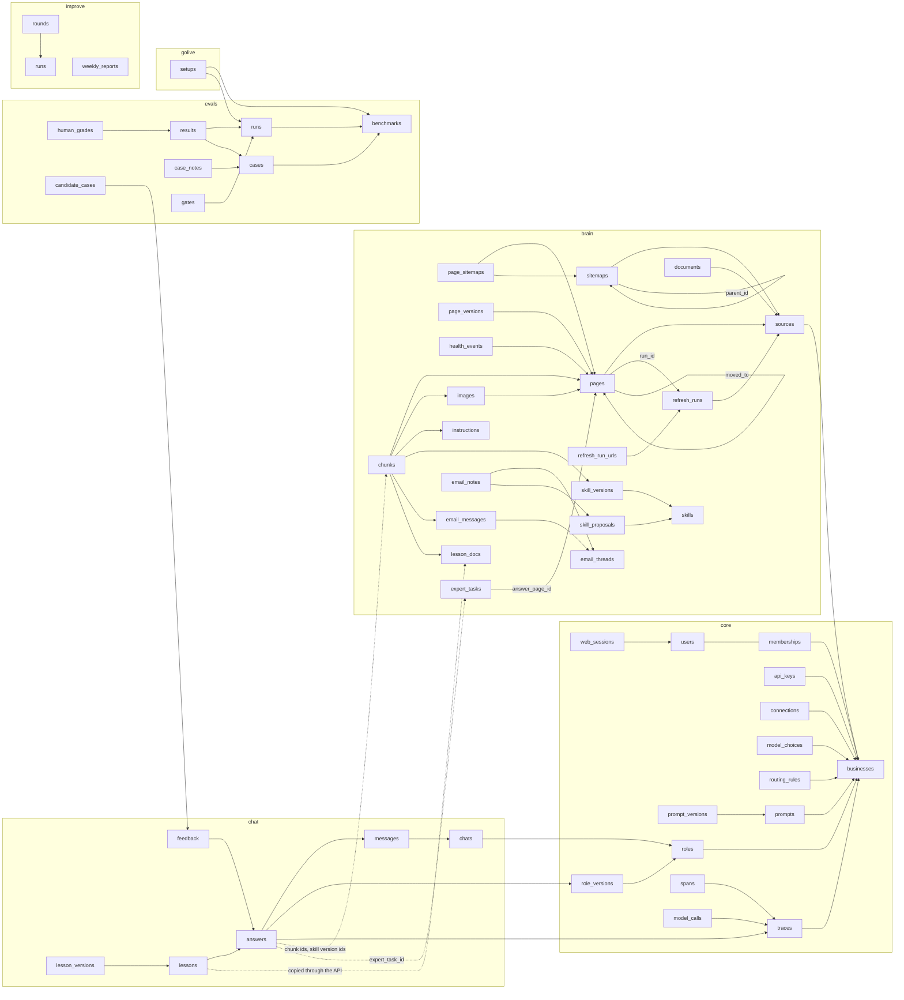

# DATABASE.md

One PostgreSQL 18 database with pgvector 0.8.7 and pg_trgm. 57 tables in 6 schemas, one schema
per main feature plus a shared core. Every table, column, key and index is listed in
[the reference](#reference-every-table-column-key-and-index) at the end, generated from the
models by `scripts/db_reference.py`, so it can't drift from the code.

The first migration is [`migrations/versions/0001_first_schema.py`](migrations/versions/0001_first_schema.py):
every table and index, row-level security on every business-owned table, what each database
role may touch, five small SQL functions and Procrastinate's job tables.
`alembic check` reports no difference between the models and the database.

## Schemas and who uses them

| Schema | Feature | Tables | Read and written by |
| --- | --- | --- | --- |
| `core` | Shared kernel + Feature 1 (Workspace and Settings) | users, businesses, memberships, web_sessions, api_keys, connections, model_choices, routing_rules, prompts, prompt_versions, roles, role_versions, traces, spans, model_calls, cache_entries, audit_log | web (all), brain (reads settings, keys, prompts, roles; writes its own model calls, traces, cache) |
| `brain` | Feature 2 (Knowledge Brain) | sources, sitemaps, pages, page_sitemaps, page_versions, health_events, refresh_runs, refresh_run_urls, images, documents, instructions, skills, skill_versions, skill_proposals, email_threads, email_messages, email_notes, lesson_docs, expert_tasks, chunks, terms, synonyms | **brain only** |
| `chat` | Feature 3 (Ask and Teach Chat) | chats, messages, answers, feedback, lessons, lesson_versions | web |
| `evals` | Feature 4 (Eval Lab) | benchmarks, cases, runs, results, human_grades, case_notes, candidate_cases, gates | web |
| `improve` | Feature 5 (Self-Improve Loop) | runs, rounds, weekly_reports | web |
| `golive` | Feature 6 (Go Live) | setups | web |
| `public` | Extensions and the job queue | procrastinate_jobs, procrastinate_events, procrastinate_periodic_defers, procrastinate_workers | both workers |

Three login roles (`db/init/01-roles.sh`): `consultant_owner` owns everything and runs the
migrations; `web_user` is the web app and its worker; `brain_user` is the Knowledge Brain's API
and worker. **`web_user` has no grant at all on the `brain` schema**, so the chat and the Eval Lab
can only reach the Brain's data through its HTTP API, as the brief requires. A test checks it
(`tests/test_isolation.py`).

## Which feature uses which tables

| Task | Tables (main columns) |
| --- | --- |
| 1.1 Sign-up, businesses | `users`, `businesses`, `memberships`, `web_sessions` (token_hash, csrf_token, business_id = the business picked in the switcher) |
| 1.1 Delete a business | every table: `business_id ... REFERENCES core.businesses ON DELETE CASCADE` (D14) |
| 1.2 Keys and connections | `connections` (kind, secret_enc, masked, status, last_test_message), `api_keys` (key_hash), `model_choices` (step, model_key) |
| 1.3 Prompts | `prompts` (key, required_vars), `prompt_versions` (version, body, author, status, gate_id) |
| 1.4 Roles | `roles`, `role_versions` (goal, prompt, tone, capabilities, knowledge_types, skill_keys, model_key, handover) |
| 1.5 Logs, cost, traces | `model_calls` (D13), `traces`, `spans`, `audit_log`; failed jobs: `procrastinate_jobs` (status = 'failed') |
| 2.1 Five knowledge types | `sources` (kind), `instructions`, `skills`, `email_threads`; `chunks.knowledge_type` on every searchable piece |
| 2.2 Sitemaps and page URLs | `sources`, `sitemaps` (parent_id, url_count, first_url, last_url), `pages`, `page_sitemaps` (duplicates) |
| 2.3 Polite first read | `pages` (fetch_state, run_id, claimed_at, attempts), `refresh_runs`, `images` (sha256, description) |
| 2.4 Fresh, health levels | `pages` (level, miss_count, moved_to_page_id), `health_events`, `page_versions`, `refresh_runs` (first_fetch_at, last_fetch_at), `refresh_run_urls` |
| 2.5 Instructions and skills | `instructions` (all_roles, role_ids), `skills`, `skill_versions` |
| 2.6 Past emails | `email_threads`, `email_messages`, `email_notes`, `skill_proposals` (note_ids) |
| 2.7 Search | `chunks` (tsv, embedding), `terms` (typos), `synonyms` |
| 3.1-3.3 Chat and trace | `chats` (mode, role_id), `messages`, `answers` (citations, knowledge_types, skill_version_ids, lesson_ids, prompt_versions, role_version_id, trace_id, cost_usd) |
| 3.2 Ask a human | `brain.expert_tasks` (through the Brain's API); the answer becomes a `pages` row with origin 'expert' |
| 3.4 Lessons | `feedback`, `lessons`, `lesson_versions`; approved lessons copied to `brain.lesson_docs` (through the API) |
| 4.1-4.2 Benchmark, judge, compare | `benchmarks`, `cases`, `runs`, `results` (judge_score, judge_reason, second_score, latency_ms, cost_usd), `human_grades`, `case_notes` |
| 4.3 Router | `routing_rules`; every choice in `model_calls.route` |
| 4.4 Feedback to tests | `feedback` -> `candidate_cases` -> `cases` |
| 4.5 Release gate | `gates`; `prompt_versions.status`, `role_versions.status`, `skill_versions.status` |
| 5.1-5.3 Self-Improve | `improve.runs` (branch, packet, limits, scores_before/after, violations, report_md), `improve.rounds` |
| 5.4 Weekly email | `improve.weekly_reports` |
| 6.1-6.4 Go Live | `golive.setups` (step_times, starter_benchmark_id, readiness_correct/total); `businesses.chat_enabled`, `readiness_threshold` |

## The diagram

Every table in `brain`, `chat`, `evals`, `improve` and `golive`, and most of `core`, also points at
`core.businesses` (left out below to keep the picture readable). Dotted lines cross the API
boundary: they are ids the chat keeps, not foreign keys, because the web role can't see `brain`.



## How each business's data is kept apart

Four layers, from the database out:

1. **A `business_id` on every business-owned table, with row-level security.** Each policy is
   `USING (business_id = core.current_business()) WITH CHECK (business_id = core.current_business())`.
   `core.current_business()` reads `app.business_id`, which `core/db.py` sets with
   `set_config('app.business_id', ..., true)` at the start of **every** transaction (the `true`
   makes it last for that transaction only, so a pooled connection never carries one business's
   id into another's request). With no business set, a query sees no rows at all. A forged id
   in a URL finds nothing, because the policy filters on the transaction's business, not on
   what the request asks for.
2. **Separate database roles.** The app never connects as the owner (owners skip row-level
   security). `web_user` can't touch `brain`; `brain_user` can't touch `chat`, `evals`,
   `improve` or `golive`.
3. **The Brain's API keys are per business.** The key decides the business
   (`core.business_for_api_key`), never a parameter in the request.
4. **Tests prove it** (`tests/test_isolation.py`): business B's session can't read, update or
   delete any row of business A in any of the 55 protected tables, through the database or the
   API; a request with A's key and B's ids gets 404; the web role is refused on `brain`.

What is not behind row-level security, and why: `users` and `web_sessions` (a person exists
before choosing a business; sessions are looked up by a token hash), and Procrastinate's tables
(both services must defer and fetch jobs; job arguments carry ids only, never content).

## Indexes, and why each one

| Index | Why |
| --- | --- |
| `business_id` on every tenant table | Every query filters on it through row-level security; deleting a business cascades through it |
| `brain.chunks` GIN on `tsv` | Keyword search (`websearch_to_tsquery` + `ts_rank_cd`) without scanning |
| `brain.chunks` HNSW on `embedding` (`halfvec_cosine_ops`, m=16, ef_construction=64) | Meaning search in milliseconds; HNSW needs no training step and handles inserts (D7) |
| `brain.chunks (business_id, knowledge_type)` | Search inside one knowledge type (a role allowed only some types) |
| `brain.chunks` on each source column (page_id, image_id, instruction_id, ...) | Re-chunking or switching off one source finds its chunks at once; cascades stay fast |
| `brain.terms` GIN trigram on `term` | "custmize" finds "customize" with `similarity()` in a few ms (D8) |
| `brain.pages (business_id, url)` unique | One row per URL per business (D3); the crawler upserts on it |
| `brain.pages (business_id, level)` | Pending actions and the archived knowledge base |
| `brain.pages (business_id, run_id, fetch_state)` | The read queue: the next batch of pending pages of a run |
| `brain.images (business_id, sha256)` | The same screenshot is described once per business |
| `brain.page_sitemaps (sitemap_id)` | Duplicates and per-sitemap counts |
| `brain.expert_tasks (business_id, question_key) WHERE status = 'open'` unique | Asking the same unanswered question again adds to its count |
| `brain.sources (next_check_at)` | The scheduler's "which sources are due?" |
| `core.model_calls (business_id, created_at DESC)` and `(business_id, job, model_key)` | The cost dashboard: recent calls, cost per step per model |
| `core.model_calls (trace_id)`, `core.spans (trace_id)` | The trace panel: every step of one answer |
| `*_versions (parent_id) WHERE status = 'live'` unique | Exactly one live version of each prompt, role and skill |
| `core.api_keys (key_hash)` unique | One lookup per API request |
| `evals.results (run_id, case_id, model_key)` unique | A rerun of a case overwrites, never duplicates; a stopped run resumes where it was |

## Answers to D1 to D15

**D1. Keeping businesses apart.** Pick: a `business_id` on every table with row-level security.
Why: one set of tables and one migration path; the database enforces it even if a query forgets a
filter; tests prove it. Why not one schema per business: 1,000 businesses would mean 57,000 tables,
1,000 migrations per release and a bloated catalog. Why not one database per business: 1,000
connection pools, and cross-business jobs (the weekly email, the scheduler) become 1,000 jobs.
What breaks first at 1,000 businesses: the shared HNSW index on `chunks`. At about 7 chunks per
page (measured: 10,825 chunks for 1,541 articles), 1,000 businesses with 500 pages each is 3.5
million vectors; a filtered search then scans more of the graph. pgvector 0.8's iterative index
scans (`hnsw.iterative_scan = relaxed_order`) handle the filter; past that, partition `chunks` by
`business_id` (hash, 16 partitions) so each index is smaller, and give the largest businesses their
own partition.

**D2. A sitemap inside another.** Pick: a `parent_id` column on `brain.sitemaps` (plus `depth`). A
sitemap index has children, each child has one parent, so a self-reference is the simplest exact
model; the summary's per-sitemap totals are one recursive query. A link table would allow many
parents, which never happens; JSON can't be joined or constrained.

**D3. The same URL in 3 sitemaps.** One `pages` row (unique on `business_id, url`) and three rows
in the link table `brain.page_sitemaps`, keyed by `(page_id, sitemap_id)`. A page with more than one
row whose `removed_at` is empty is a duplicate, and the screen lists every sitemap it is in. The page
is read, embedded and answered from once.

**D4. URL health.** Both: `pages.level` and `pages.miss_count` are the current state (fast filters,
"never in answers" is `level IN ('active', 'watch')`), and `brain.health_events` keeps every
change (missing, not_found, moved, recovered, quarantined, archived, restored) for the audit. The one
query for pending URLs and their counts:

```sql
SELECT p.url, p.level, p.miss_count, s.miss_threshold, s.action_rule
FROM brain.pages p
JOIN brain.sources s ON s.id = p.source_id
WHERE p.level IN ('watch', 'quarantined')
  AND p.miss_count >= s.miss_threshold * CASE WHEN p.level = 'quarantined' THEN 2 ELSE 1 END
ORDER BY p.miss_count DESC, p.url;
```

(Row-level security adds `business_id = <this business>` by itself. With the rule "quarantine, then
archive", a URL is proposed for quarantine at X misses and for archiving at 2X.)

**D5. Change history.** Pick: keep a full copy of a page only when its content hash changes
(`brain.page_versions`), with lines added and removed counted for the history list; the diff is
computed when someone opens it. Overwriting loses the audit trail; storing only differences makes
reading an old version a chain of patches. Space for 1,000 pages checked daily for a year, with the
measured average article of 3,880 characters: at 1% of pages changing a day, 3,650 versions, 14 MB
of text, about 6 MB after Postgres compresses it (TOAST, ~2.5x on prose). At 5% a day, 71 MB raw,
about 28 MB stored. Even if every page changed every day, 1.4 GB raw, about 0.6 GB stored; at that
point we'd switch old versions to stored diffs. The v1 crawler's first recheck of 1,700 pages found 0
changes, so the 1% case is the realistic one.

**D6. Chunks.** 300 to 500 tokens (measured average: 317), split at headings first, then at
paragraph ends, never inside a paragraph; no overlap, because every chunk starts with its heading
path ("Emails > Email Accounts > Add an account > Step 2"), which carries the context an overlap
would. Each chunk keeps the anchor of its first paragraph, so a citation opens the exact paragraph.
An image's description is its own chunk (`image_id` set, heading "... > Screenshot 3"), so a
screenshot can be found by what it shows, cited and opened on its own; its paragraph's text stays in
the page chunk.

**D7. Vectors.** `halfvec(1024)`: voyage-4-lite gives 1,024 numbers; half precision stores 2 KB per
chunk instead of 4 KB (at 50,000 pages: 0.7 GB instead of 1.4 GB) with no measurable change in
cosine ranking at this size. HNSW, not IVFFlat: no training on existing rows (IVFFlat's lists go stale
as pages change), better recall at the same speed, and it works on an empty table. Changing the
embedding model: every chunk records `embedding_model`; a re-embed job writes new vectors in batches,
and search uses only vectors of the business's current model, so answers keep working during the
switch. A different size means a new column and index in a migration.

**D8. Keyword search.** Both. Postgres full-text search (`english` config, so "customize",
"customized" and "customization" all stem to "custom") finds whole words, weighted so heading words
count more. `pg_trgm` fixes typos: each query word that isn't in the business's vocabulary
(`brain.terms`) is replaced by its closest known word: trigram candidates with `similarity() >= 0.2`, kept only within 1 edit for words of up to 5 letters and 2 edits for longer ones (Damerau-Levenshtein), so "custmize" becomes "customize", and a word already in the vocabulary is never changed. Keyword and
vector lists are combined with reciprocal rank fusion (`score = sum of 1 / (60 + rank)`), which needs
no tuning between scales that don't compare, then the top 20 are re-ranked (title and heading
matches, share of question words covered). In local-only mode, or without a Voyage key, the vector
list is skipped and the same fusion runs on keywords and typo-fixed keywords.

**D9. Past emails.** Store the text of every message (personal data masked first) in
`brain.email_messages`, with Gmail's ids. Notes point at exact messages, people read threads in the
app, and search indexes them; fetching each time would spend Gmail quota and break when a thread is
deleted. A thread is fetched again only if Gmail's `historyId` changed (unique on
`business_id, gmail_thread_id`). Notes: `brain.email_notes`, with `message_id` empty for a note on the
whole thread. Attachments: names, types and sizes only, never the files: they add risk and size,
and the notes are about the replies.

**D10. Teaching.** The wrong answer is a `chat.messages` row with its `chat.answers` row; the human's
correction is `chat.feedback` (verdict, why, correct_answer) or a teaching message in the chat; the
lesson is `chat.lessons` + `chat.lesson_versions`, which point back to `chat_id` and `answer_id`
(and `feedback.lesson_id` points forward). When the correction fits a whole kind of work, the lesson
writer proposes a skill change instead: `brain.skill_proposals` (through the API), linked from
`lessons.skill_proposal_id`.

**D11. Chats.** `chat.chats` holds the mode (ask or teach) and the current role; each message keeps
the role it was written in (the role can change mid-chat). Each agent answer has a `chat.answers` row
listing exactly what it used: `chunk_ids`, `knowledge_types`, `skill_version_ids`, `lesson_ids`,
`instruction_ids`, `citations` (what it shows, with anchors), plus its model, cost and `trace_id`.

**D12. Skills and instructions.** A skill is `brain.skills` + one `brain.skill_versions` row per change
(Markdown, status, author, who approved it); exactly one version is live. The notes that changed it:
`brain.skill_proposals.note_ids`, and each note points back at its proposal
(`email_notes.proposal_id`). Restoring an old version copies it into a new version, so history is never
rewritten. Instructions: `brain.instructions` with `all_roles` (true: every role) or the chosen
`role_ids`.

**D13. Every model call.** `core.model_calls`, one row per call: business, trace, step, router job,
provider, model key and exact model id, prompt key and prompt version, role version, input, output,
cache-write and cache-read tokens, cost in $ (`numeric(12,6)`), latency in ms, status (ok, error,
refused), the error, the router's decision (token count and how it was counted, complexity, model
picked and why, moved up or to a fallback), and masked, cut-short previews. Keys are never written.
`core.traces` and `core.spans` hold the non-model steps (shield, search, citation check) of the same
run, for the tracing dashboard.

**D14. Deleting a business.** In order: (1) the Brain's API deletes the business's files under
`storage/images/<business>/` and `storage/documents/<business>/`; (2) the web app revokes the Google
token with Google and deletes `storage/lessons/<business>/` and `storage/reports/<business>/`;
(3) it deletes queued Procrastinate jobs whose arguments carry the business id; (4) it deletes the
`core.businesses` row, and `ON DELETE CASCADE` removes the rest in the same transaction: in `core`
api_keys, connections, model_choices, routing_rules, prompts, prompt_versions, roles,
role_versions, traces, spans, model_calls, cache_entries, audit_log, memberships (and web_sessions'
business is set to empty); every table in `brain` (sources, sitemaps, pages, page_sitemaps,
page_versions, health_events, refresh_runs, refresh_run_urls, images, documents, instructions,
skills, skill_versions, skill_proposals, email_threads, email_messages, email_notes, lesson_docs,
expert_tasks, chunks with their embeddings, terms, synonyms); every table in `chat`, `evals`,
`improve` and `golive`. A test counts the business's rows in all 57 tables afterwards and expects 0.

**D15. Prompts and roles.** `core.prompts` + `core.prompt_versions` (every save a new row: body,
variables, author default/human/self_improve, status, the gate that decided it); `core.roles` +
`core.role_versions` (goal, prompt, tone, capabilities, knowledge types, skills, model, handover
rules). Each answer links back through `chat.answers.prompt_versions` ({prompt key: version id}) and
`chat.answers.role_version_id`; each model call through `model_calls.prompt_version_id` and
`role_version_id`. Restoring an old version or the default copies it into a new live version.

## Reference: every table, column, key and index

<!-- Generated by scripts/db_reference.py from the models. Do not edit by hand. -->

### Schema `core` (17 tables)

#### `core.api_keys`

A key for the Knowledge Brain's API. Only the SHA-256 is stored; the key is shown once.

| Column | Type | Null | Default | Keys |
| --- | --- | --- | --- | --- |
| id | uuid | no | gen_random_uuid() | PK |
| name | text | no |  |  |
| prefix | text | no |  |  |
| key_hash | text | no |  |  |
| created_by | uuid | yes |  | FK core.users.id (SET NULL) |
| created_at | timestamp with time zone | no | now() |  |
| last_used_at | timestamp with time zone | yes |  |  |
| revoked_at | timestamp with time zone | yes |  |  |
| business_id | uuid | no |  | FK core.businesses.id (CASCADE) |

Indexes and constraints: unique (key_hash); `ix_api_keys_business_id` on (business_id).

#### `core.audit_log`

Who did what: approvals, deletions, key changes, publishing a version.

| Column | Type | Null | Default | Keys |
| --- | --- | --- | --- | --- |
| id | bigint | no |  | PK |
| user_id | uuid | yes |  | FK core.users.id (SET NULL) |
| action | text | no |  |  |
| target | text | no |  |  |
| detail | jsonb | no | '{}'::jsonb |  |
| created_at | timestamp with time zone | no | now() |  |
| business_id | uuid | no |  | FK core.businesses.id (CASCADE) |

Indexes and constraints: `ix_audit_log_business_id` on (business_id).

#### `core.businesses`

One client company. Every other business-owned row points here.

| Column | Type | Null | Default | Keys |
| --- | --- | --- | --- | --- |
| id | uuid | no | gen_random_uuid() | PK |
| name | text | no |  |  |
| slug | text | no |  |  |
| tone | text | no | friendly, clear and short |  |
| local_only | boolean | no | false |  |
| chat_enabled | boolean | no | false |  |
| readiness_threshold | integer | no | 90 |  |
| dont_know_threshold | double precision | no | 0.3 |  |
| internal_key_enc | bytea | yes |  |  |
| advanced | jsonb | no | '{}'::jsonb |  |
| created_by | uuid | yes |  | FK core.users.id (SET NULL) |
| created_at | timestamp with time zone | no | now() |  |

Indexes and constraints: unique (slug).

#### `core.cache_entries`

The cache behind core/cache.py's interface. A Valkey server can replace it later.

| Column | Type | Null | Default | Keys |
| --- | --- | --- | --- | --- |
| business_id | uuid | no |  | PK, FK core.businesses.id (CASCADE) |
| key | text | no |  | PK |
| value | jsonb | no |  |  |
| expires_at | timestamp with time zone | yes |  |  |

Indexes and constraints: `ix_cache_entries_expires_at` on (expires_at).

#### `core.connections`

One of the 5 connections (Task 1.2): claude, gemini, openrouter, ollama, google.

| Column | Type | Null | Default | Keys |
| --- | --- | --- | --- | --- |
| id | uuid | no | gen_random_uuid() | PK |
| kind | text | no |  |  |
| secret_enc | bytea | yes |  |  |
| masked | text | yes |  |  |
| config | jsonb | no | '{}'::jsonb |  |
| status | text | no | untested |  |
| last_tested_at | timestamp with time zone | yes |  |  |
| last_test_message | text | yes |  |  |
| updated_at | timestamp with time zone | no | now() |  |
| business_id | uuid | no |  | FK core.businesses.id (CASCADE) |

Indexes and constraints: unique (business_id, kind); `ix_connections_business_id` on (business_id).

#### `core.memberships`

Who belongs to which business, and as what (owner or member).

| Column | Type | Null | Default | Keys |
| --- | --- | --- | --- | --- |
| business_id | uuid | no |  | PK, FK core.businesses.id (CASCADE) |
| user_id | uuid | no |  | PK, FK core.users.id (CASCADE) |
| role | text | no | member |  |
| created_at | timestamp with time zone | no | now() |  |

Indexes and constraints: `ix_memberships_user_id` on (user_id).

#### `core.model_calls`

The ledger (Task 1.5, D13): one row per model call, ready for billing. Text previews are masked (core/pii.py) and cut short. Keys never reach this table.

| Column | Type | Null | Default | Keys |
| --- | --- | --- | --- | --- |
| id | bigint | no |  | PK |
| trace_id | uuid | yes |  | FK core.traces.id (SET NULL) |
| step | text | no |  |  |
| job | text | no |  |  |
| provider | text | no |  |  |
| model_key | text | no |  |  |
| provider_model | text | no |  |  |
| prompt_key | text | yes |  |  |
| prompt_version_id | uuid | yes |  |  |
| role_version_id | uuid | yes |  |  |
| input_tokens | integer | no | 0 |  |
| output_tokens | integer | no | 0 |  |
| cache_write_tokens | integer | no | 0 |  |
| cache_read_tokens | integer | no | 0 |  |
| cost_usd | numeric(12, 6) | no | 0 |  |
| latency_ms | integer | no | 0 |  |
| status | text | no |  |  |
| error | text | yes |  |  |
| route | jsonb | no | '{}'::jsonb |  |
| request_preview | text | yes |  |  |
| response_preview | text | yes |  |  |
| created_at | timestamp with time zone | no | now() |  |
| business_id | uuid | no |  | FK core.businesses.id (CASCADE) |

Indexes and constraints: `ix_model_calls_business_created` on (business_id, created_at DESC); `ix_model_calls_business_id` on (business_id); `ix_model_calls_business_job_model` on (business_id, job, model_key); `ix_model_calls_trace_id` on (trace_id).

#### `core.model_choices`

The model the business picked for one step (Task 1.2), from the 14 in the registry.

| Column | Type | Null | Default | Keys |
| --- | --- | --- | --- | --- |
| id | uuid | no | gen_random_uuid() | PK |
| step | text | no |  |  |
| model_key | text | no |  |  |
| updated_by | uuid | yes |  | FK core.users.id (SET NULL) |
| updated_at | timestamp with time zone | no | now() |  |
| business_id | uuid | no |  | FK core.businesses.id (CASCADE) |

Indexes and constraints: unique (business_id, step); `ix_model_choices_business_id` on (business_id).

#### `core.prompt_versions`

Every save of a prompt is a new row. Exactly one version per prompt is live.

| Column | Type | Null | Default | Keys |
| --- | --- | --- | --- | --- |
| id | uuid | no | gen_random_uuid() | PK |
| prompt_id | uuid | no |  | FK core.prompts.id (CASCADE) |
| version | integer | no |  |  |
| body | text | no |  |  |
| variables | text[] | no | '{}' |  |
| author | text | no |  |  |
| status | text | no |  |  |
| note | text | yes |  |  |
| gate_id | uuid | yes |  |  |
| created_by | uuid | yes |  | FK core.users.id (SET NULL) |
| approved_by | uuid | yes |  | FK core.users.id (SET NULL) |
| created_at | timestamp with time zone | no | now() |  |
| business_id | uuid | no |  | FK core.businesses.id (CASCADE) |

Indexes and constraints: unique (prompt_id, version); `ix_prompt_versions_business_id` on (business_id); unique `uq_prompt_versions_one_live` on (prompt_id) where status = 'live'.

#### `core.prompts`

One prompt the app sends to a model (Task 1.3). Its text lives in its versions.

| Column | Type | Null | Default | Keys |
| --- | --- | --- | --- | --- |
| id | uuid | no | gen_random_uuid() | PK |
| key | text | no |  |  |
| title | text | no |  |  |
| description | text | no |  |  |
| kind | text | no |  |  |
| required_vars | text[] | no | '{}' |  |
| advanced | boolean | no | false |  |
| created_at | timestamp with time zone | no | now() |  |
| business_id | uuid | no |  | FK core.businesses.id (CASCADE) |

Indexes and constraints: unique (business_id, key); `ix_prompts_business_id` on (business_id).

#### `core.role_versions`

Every save of a role is a new row; exactly one is live. Answers point at the version.

| Column | Type | Null | Default | Keys |
| --- | --- | --- | --- | --- |
| id | uuid | no | gen_random_uuid() | PK |
| role_id | uuid | no |  | FK core.roles.id (CASCADE) |
| version | integer | no |  |  |
| goal | text | no |  |  |
| prompt | text | no |  |  |
| tone | text | no |  |  |
| capabilities | text[] | no | '{}' |  |
| knowledge_types | text[] | no | '{}' |  |
| skill_keys | text[] | no | '{}' |  |
| model_key | text | yes |  |  |
| handover | jsonb | no | '{}'::jsonb |  |
| author | text | no |  |  |
| status | text | no |  |  |
| note | text | yes |  |  |
| gate_id | uuid | yes |  |  |
| created_by | uuid | yes |  | FK core.users.id (SET NULL) |
| created_at | timestamp with time zone | no | now() |  |
| business_id | uuid | no |  | FK core.businesses.id (CASCADE) |

Indexes and constraints: unique (role_id, version); `ix_role_versions_business_id` on (business_id); unique `uq_role_versions_one_live` on (role_id) where status = 'live'.

#### `core.roles`

An agent role (Task 1.4): Support Engineer, Support Executive, AI Consultant, or new.

| Column | Type | Null | Default | Keys |
| --- | --- | --- | --- | --- |
| id | uuid | no | gen_random_uuid() | PK |
| key | text | no |  |  |
| name | text | no |  |  |
| builtin | boolean | no | false |  |
| archived_at | timestamp with time zone | yes |  |  |
| created_at | timestamp with time zone | no | now() |  |
| business_id | uuid | no |  | FK core.businesses.id (CASCADE) |

Indexes and constraints: unique (business_id, key); `ix_roles_business_id` on (business_id).

#### `core.routing_rules`

The routing table (Task 4.3): for a job and a complexity, the model to use first.

| Column | Type | Null | Default | Keys |
| --- | --- | --- | --- | --- |
| id | uuid | no | gen_random_uuid() | PK |
| job | text | no |  |  |
| complexity | text | no |  |  |
| model_key | text | no |  |  |
| source | text | no | default |  |
| updated_at | timestamp with time zone | no | now() |  |
| business_id | uuid | no |  | FK core.businesses.id (CASCADE) |

Indexes and constraints: unique (business_id, job, complexity); `ix_routing_rules_business_id` on (business_id).

#### `core.spans`

One step inside a trace: shield, search, routing, a model call, the citation check.

| Column | Type | Null | Default | Keys |
| --- | --- | --- | --- | --- |
| id | bigint | no |  | PK |
| trace_id | uuid | no |  | FK core.traces.id (CASCADE) |
| name | text | no |  |  |
| started_at | timestamp with time zone | no | now() |  |
| duration_ms | integer | no | 0 |  |
| attrs | jsonb | no | '{}'::jsonb |  |
| business_id | uuid | no |  | FK core.businesses.id (CASCADE) |

Indexes and constraints: `ix_spans_business_id` on (business_id); `ix_spans_trace_id` on (trace_id).

#### `core.traces`

One run of something: a chat answer, an eval case, a job. Its steps are spans.

| Column | Type | Null | Default | Keys |
| --- | --- | --- | --- | --- |
| id | uuid | no | gen_random_uuid() | PK |
| kind | text | no |  |  |
| title | text | no |  |  |
| status | text | no | running |  |
| started_at | timestamp with time zone | no | now() |  |
| finished_at | timestamp with time zone | yes |  |  |
| business_id | uuid | no |  | FK core.businesses.id (CASCADE) |

Indexes and constraints: `ix_traces_business_id` on (business_id); `ix_traces_business_started` on (business_id, started_at DESC).

#### `core.users`

A person who signs in. Not tied to one business: a user can belong to several.

| Column | Type | Null | Default | Keys |
| --- | --- | --- | --- | --- |
| id | uuid | no | gen_random_uuid() | PK |
| email | text | no |  |  |
| name | text | no |  |  |
| password_hash | text | no |  |  |
| created_at | timestamp with time zone | no | now() |  |
| last_login_at | timestamp with time zone | yes |  |  |

Indexes and constraints: unique (email).

#### `core.web_sessions`

A signed-in browser. The cookie holds a random token; only its SHA-256 is stored.

| Column | Type | Null | Default | Keys |
| --- | --- | --- | --- | --- |
| token_hash | text | no |  | PK |
| user_id | uuid | no |  | FK core.users.id (CASCADE) |
| business_id | uuid | yes |  | FK core.businesses.id (SET NULL) |
| csrf_token | text | no |  |  |
| created_at | timestamp with time zone | no | now() |  |
| expires_at | timestamp with time zone | no |  |  |

Indexes and constraints: `ix_web_sessions_user_id` on (user_id).


### Schema `brain` (22 tables)

#### `brain.chunks`

A searchable piece of knowledge, with its words (tsv) and its meaning (embedding). Exactly one of the source columns is set, matching knowledge_type. `searchable` is kept in step with the source: a quarantined page, a switched-off instruction or lesson, a retired skill version all turn it false, so search never shows them (D6-D8).

| Column | Type | Null | Default | Keys |
| --- | --- | --- | --- | --- |
| id | bigint | no |  | PK |
| knowledge_type | text | no |  |  |
| page_id | uuid | yes |  | FK brain.pages.id (CASCADE) |
| image_id | uuid | yes |  | FK brain.images.id (CASCADE) |
| instruction_id | uuid | yes |  | FK brain.instructions.id (CASCADE) |
| skill_version_id | uuid | yes |  | FK brain.skill_versions.id (CASCADE) |
| email_message_id | uuid | yes |  | FK brain.email_messages.id (CASCADE) |
| lesson_doc_id | uuid | yes |  | FK brain.lesson_docs.id (CASCADE) |
| position | integer | no |  |  |
| heading | text | no |  |  |
| anchor | text | yes |  |  |
| content | text | no |  |  |
| token_count | integer | no |  |  |
| searchable | boolean | no | true |  |
| embedding | halfvec(1024) | yes |  |  |
| embedding_model | text | yes |  |  |
| tsv | tsvector | no | computed |  |
| created_at | timestamp with time zone | no | now() |  |
| business_id | uuid | no |  | FK core.businesses.id (CASCADE) |

Indexes and constraints: `ix_chunks_business_id` on (business_id); `ix_chunks_business_type` on (business_id, knowledge_type); `ix_chunks_email_message_id` on (email_message_id); `ix_chunks_embedding_hnsw` on (embedding) using hnsw; `ix_chunks_image_id` on (image_id); `ix_chunks_instruction_id` on (instruction_id); `ix_chunks_lesson_doc_id` on (lesson_doc_id); `ix_chunks_page_id` on (page_id); `ix_chunks_skill_version_id` on (skill_version_id); `ix_chunks_tsv` on (tsv) using gin.

#### `brain.documents`

An uploaded file (PDF, DOCX, Markdown, text). Its text is stored as a page.

| Column | Type | Null | Default | Keys |
| --- | --- | --- | --- | --- |
| id | uuid | no | gen_random_uuid() | PK |
| source_id | uuid | no |  | FK brain.sources.id (CASCADE) |
| page_id | uuid | yes |  | FK brain.pages.id (SET NULL) |
| filename | text | no |  |  |
| mime | text | no |  |  |
| size_bytes | integer | no |  |  |
| sha256 | text | no |  |  |
| storage_path | text | no |  |  |
| uploaded_by | uuid | yes |  | FK core.users.id (SET NULL) |
| created_at | timestamp with time zone | no | now() |  |
| business_id | uuid | no |  | FK core.businesses.id (CASCADE) |

Indexes and constraints: `ix_documents_business_id` on (business_id); `ix_documents_source_id` on (source_id).

#### `brain.email_messages`

One message in a thread. Attachments: names and sizes only, never the files (D9).

| Column | Type | Null | Default | Keys |
| --- | --- | --- | --- | --- |
| id | uuid | no | gen_random_uuid() | PK |
| thread_id | uuid | no |  | FK brain.email_threads.id (CASCADE) |
| gmail_message_id | text | no |  |  |
| position | integer | no |  |  |
| from_addr | text | no |  |  |
| to_addrs | text[] | no | '{}' |  |
| sent_at | timestamp with time zone | yes |  |  |
| subject | text | no |  |  |
| body_text | text | no |  |  |
| attachments | jsonb | no | '[]'::jsonb |  |
| business_id | uuid | no |  | FK core.businesses.id (CASCADE) |

Indexes and constraints: unique (business_id, gmail_message_id); `ix_email_messages_business_id` on (business_id); `ix_email_messages_thread_id` on (thread_id).

#### `brain.email_notes`

A person's note on a whole thread (message_id empty) or on one message (D9).

| Column | Type | Null | Default | Keys |
| --- | --- | --- | --- | --- |
| id | uuid | no | gen_random_uuid() | PK |
| thread_id | uuid | no |  | FK brain.email_threads.id (CASCADE) |
| message_id | uuid | yes |  | FK brain.email_messages.id (CASCADE) |
| body | text | no |  |  |
| status | text | no | new |  |
| proposal_id | uuid | yes |  | FK brain.skill_proposals.id (SET NULL) |
| author_id | uuid | yes |  | FK core.users.id (SET NULL) |
| created_at | timestamp with time zone | no | now() |  |
| business_id | uuid | no |  | FK core.businesses.id (CASCADE) |

Indexes and constraints: `ix_email_notes_business_id` on (business_id); `ix_email_notes_thread_id` on (thread_id).

#### `brain.email_threads`

A Gmail thread (D9: the text is stored, masked; Gmail is asked only once per thread).

| Column | Type | Null | Default | Keys |
| --- | --- | --- | --- | --- |
| id | uuid | no | gen_random_uuid() | PK |
| gmail_thread_id | text | no |  |  |
| subject | text | no |  |  |
| participants | text[] | no | '{}' |  |
| snippet | text | yes |  |  |
| message_count | integer | no | 0 |  |
| last_message_at | timestamp with time zone | yes |  |  |
| history_id | text | yes |  |  |
| fetched_at | timestamp with time zone | no | now() |  |
| business_id | uuid | no |  | FK core.businesses.id (CASCADE) |

Indexes and constraints: unique (business_id, gmail_thread_id); `ix_email_threads_business_id` on (business_id).

#### `brain.expert_tasks`

A question the agent couldn't answer, waiting for a human expert (Task 3.2). The expert's answer is saved as a page (origin expert), so the next search finds it.

| Column | Type | Null | Default | Keys |
| --- | --- | --- | --- | --- |
| id | uuid | no | gen_random_uuid() | PK |
| question | text | no |  |  |
| question_key | text | no |  |  |
| reason | text | no |  |  |
| context | jsonb | no | '{}'::jsonb |  |
| status | text | no | open |  |
| asked_count | integer | no | 1 |  |
| last_asked_at | timestamp with time zone | no | now() |  |
| answer | text | yes |  |  |
| answered_by | uuid | yes |  | FK core.users.id (SET NULL) |
| answered_at | timestamp with time zone | yes |  |  |
| answer_page_id | uuid | yes |  | FK brain.pages.id (SET NULL) |
| created_at | timestamp with time zone | no | now() |  |
| business_id | uuid | no |  | FK core.businesses.id (CASCADE) |

Indexes and constraints: `ix_expert_tasks_business_id` on (business_id); unique `uq_expert_tasks_open_question` on (business_id, question_key) where status = 'open'.

#### `brain.health_events`

The health history of a URL (D4): every miss, move, recovery and level change.

| Column | Type | Null | Default | Keys |
| --- | --- | --- | --- | --- |
| id | bigint | no |  | PK |
| page_id | uuid | no |  | FK brain.pages.id (CASCADE) |
| run_id | uuid | yes |  | FK brain.refresh_runs.id (SET NULL) |
| event | text | no |  |  |
| from_level | text | no |  |  |
| to_level | text | no |  |  |
| miss_count | integer | no |  |  |
| detail | text | yes |  |  |
| created_by | uuid | yes |  | FK core.users.id (SET NULL) |
| created_at | timestamp with time zone | no | now() |  |
| business_id | uuid | no |  | FK core.businesses.id (CASCADE) |

Indexes and constraints: `ix_health_events_business_id` on (business_id); `ix_health_events_page_id` on (page_id).

#### `brain.images`

A screenshot on a page, and what a model says it shows (Task 2.3).

| Column | Type | Null | Default | Keys |
| --- | --- | --- | --- | --- |
| id | uuid | no | gen_random_uuid() | PK |
| page_id | uuid | no |  | FK brain.pages.id (CASCADE) |
| position | integer | no |  |  |
| src_url | text | no |  |  |
| alt | text | yes |  |  |
| context | text | yes |  |  |
| sha256 | text | yes |  |  |
| storage_path | text | yes |  |  |
| description | text | yes |  |  |
| described_by | text | yes |  |  |
| state | text | no | pending |  |
| error | text | yes |  |  |
| created_at | timestamp with time zone | no | now() |  |
| business_id | uuid | no |  | FK core.businesses.id (CASCADE) |

Indexes and constraints: unique (page_id, position); `ix_images_business_id` on (business_id); `ix_images_business_sha256` on (business_id, sha256).

#### `brain.instructions`

A rule a person wrote in plain words (Task 2.5), for all roles or for chosen roles.

| Column | Type | Null | Default | Keys |
| --- | --- | --- | --- | --- |
| id | uuid | no | gen_random_uuid() | PK |
| title | text | no |  |  |
| body | text | no |  |  |
| enabled | boolean | no | true |  |
| all_roles | boolean | no | true |  |
| role_ids | uuid[] | no | '{}' |  |
| created_by | uuid | yes |  | FK core.users.id (SET NULL) |
| created_at | timestamp with time zone | no | now() |  |
| updated_at | timestamp with time zone | no | now() |  |
| business_id | uuid | no |  | FK core.businesses.id (CASCADE) |

Indexes and constraints: `ix_instructions_business_id` on (business_id).

#### `brain.lesson_docs`

An approved lesson, copied in by the chat (Task 3.4) so search can find and cite it. The chat's own tables keep the lesson's record and versions; this copy is only for search. Switching a lesson off or deleting it removes it from here.

| Column | Type | Null | Default | Keys |
| --- | --- | --- | --- | --- |
| id | uuid | no |  | PK |
| topic | text | no |  |  |
| title | text | no |  |  |
| markdown | text | no |  |  |
| version | integer | no |  |  |
| updated_at | timestamp with time zone | no | now() |  |
| business_id | uuid | no |  | FK core.businesses.id (CASCADE) |

Indexes and constraints: `ix_lesson_docs_business_id` on (business_id).

#### `brain.page_sitemaps`

Which sitemaps list a URL (D3). Two rows still listed for one page = a duplicate.

| Column | Type | Null | Default | Keys |
| --- | --- | --- | --- | --- |
| page_id | uuid | no |  | PK, FK brain.pages.id (CASCADE) |
| sitemap_id | uuid | no |  | PK, FK brain.sitemaps.id (CASCADE) |
| position | integer | no |  |  |
| lastmod | timestamp with time zone | yes |  |  |
| first_seen_at | timestamp with time zone | no | now() |  |
| last_seen_at | timestamp with time zone | no | now() |  |
| removed_at | timestamp with time zone | yes |  |  |
| business_id | uuid | no |  | FK core.businesses.id (CASCADE) |

Indexes and constraints: `ix_page_sitemaps_business_id` on (business_id); `ix_page_sitemaps_sitemap_id` on (sitemap_id).

#### `brain.page_versions`

The change history (Task 2.4, D5): a full copy each time the content hash changed.

| Column | Type | Null | Default | Keys |
| --- | --- | --- | --- | --- |
| id | bigint | no |  | PK |
| page_id | uuid | no |  | FK brain.pages.id (CASCADE) |
| version | integer | no |  |  |
| change | text | no |  |  |
| content_hash | text | no |  |  |
| title | text | yes |  |  |
| content_md | text | no |  |  |
| lines_added | integer | no | 0 |  |
| lines_removed | integer | no | 0 |  |
| run_id | uuid | yes |  | FK brain.refresh_runs.id (SET NULL) |
| created_at | timestamp with time zone | no | now() |  |
| business_id | uuid | no |  | FK core.businesses.id (CASCADE) |

Indexes and constraints: unique (page_id, version); `ix_page_versions_business_id` on (business_id).

#### `brain.pages`

One URL (from a sitemap or added alone), an uploaded document, or an expert's answer. One row per URL per business, however many sitemaps list it (D3).

| Column | Type | Null | Default | Keys |
| --- | --- | --- | --- | --- |
| id | uuid | no | gen_random_uuid() | PK |
| source_id | uuid | yes |  | FK brain.sources.id (SET NULL) |
| url | text | no |  |  |
| origin | text | no |  |  |
| kind | text | no | article |  |
| title | text | yes |  |  |
| breadcrumb | text | yes |  |  |
| content_md | text | yes |  |  |
| content_hash | text | yes |  |  |
| embedded_hash | text | yes |  |  |
| level | text | no | active |  |
| miss_count | integer | no | 0 |  |
| level_changed_at | timestamp with time zone | yes |  |  |
| moved_to_page_id | uuid | yes |  | FK brain.pages.id (SET NULL) |
| http_status | integer | yes |  |  |
| error | text | yes |  |  |
| etag | text | yes |  |  |
| last_modified | text | yes |  |  |
| sitemap_lastmod | timestamp with time zone | yes |  |  |
| fetch_state | text | no | discovered |  |
| run_id | uuid | yes |  | FK brain.refresh_runs.id (SET NULL) |
| claimed_at | timestamp with time zone | yes |  |  |
| attempts | integer | no | 0 |  |
| fetched_at | timestamp with time zone | yes |  |  |
| changed_at | timestamp with time zone | yes |  |  |
| created_at | timestamp with time zone | no | now() |  |
| business_id | uuid | no |  | FK core.businesses.id (CASCADE) |

Indexes and constraints: unique (business_id, url); `ix_pages_business_id` on (business_id); `ix_pages_business_level` on (business_id, level); `ix_pages_fetch_queue` on (business_id, run_id, fetch_state); `ix_pages_source_id` on (source_id).

#### `brain.refresh_run_urls`

Every URL a run fetched and what happened: the run's full, scrollable URL list.

| Column | Type | Null | Default | Keys |
| --- | --- | --- | --- | --- |
| id | bigint | no |  | PK |
| run_id | uuid | no |  | FK brain.refresh_runs.id (CASCADE) |
| page_id | uuid | yes |  | FK brain.pages.id (SET NULL) |
| url | text | no |  |  |
| http_status | integer | yes |  |  |
| outcome | text | no |  |  |
| fetched_at | timestamp with time zone | no | now() |  |
| business_id | uuid | no |  | FK core.businesses.id (CASCADE) |

Indexes and constraints: `ix_refresh_run_urls_business_id` on (business_id); `ix_refresh_run_urls_run_id` on (run_id).

#### `brain.refresh_runs`

One read of a source: the first full read, a scheduled recheck, or a manual one.

| Column | Type | Null | Default | Keys |
| --- | --- | --- | --- | --- |
| id | uuid | no | gen_random_uuid() | PK |
| source_id | uuid | no |  | FK brain.sources.id (CASCADE) |
| kind | text | no |  |  |
| status | text | no | running |  |
| urls_total | integer | no | 0 |  |
| fetched | integer | no | 0 |  |
| new_pages | integer | no | 0 |  |
| changed | integer | no | 0 |  |
| unchanged | integer | no | 0 |  |
| failed | integer | no | 0 |  |
| missing | integer | no | 0 |  |
| moved | integer | no | 0 |  |
| recovered | integer | no | 0 |  |
| duplicates_skipped | integer | no | 0 |  |
| first_fetch_at | timestamp with time zone | yes |  |  |
| last_fetch_at | timestamp with time zone | yes |  |  |
| started_at | timestamp with time zone | no | now() |  |
| finished_at | timestamp with time zone | yes |  |  |
| error | text | yes |  |  |
| business_id | uuid | no |  | FK core.businesses.id (CASCADE) |

Indexes and constraints: `ix_refresh_runs_business_id` on (business_id); `ix_refresh_runs_business_started` on (business_id, started_at DESC); `ix_refresh_runs_source_id` on (source_id).

#### `brain.sitemaps`

A sitemap file: one the user added, or one found inside it (nested, D2: parent_id).

| Column | Type | Null | Default | Keys |
| --- | --- | --- | --- | --- |
| id | uuid | no | gen_random_uuid() | PK |
| source_id | uuid | no |  | FK brain.sources.id (CASCADE) |
| parent_id | uuid | yes |  | FK brain.sitemaps.id (CASCADE) |
| url | text | no |  |  |
| is_index | boolean | no | false |  |
| depth | integer | no | 0 |  |
| url_count | integer | no | 0 |  |
| first_url | text | yes |  |  |
| last_url | text | yes |  |  |
| last_checked_at | timestamp with time zone | yes |  |  |
| last_error | text | yes |  |  |
| created_at | timestamp with time zone | no | now() |  |
| business_id | uuid | no |  | FK core.businesses.id (CASCADE) |

Indexes and constraints: unique (business_id, url); `ix_sitemaps_business_id` on (business_id); `ix_sitemaps_parent_id` on (parent_id); `ix_sitemaps_source_id` on (source_id).

#### `brain.skill_proposals`

A skill change a model suggested from people's notes or a lesson, waiting for a human. D12: note_ids are the notes it used. Nothing changes until a human approves (Task 2.6).

| Column | Type | Null | Default | Keys |
| --- | --- | --- | --- | --- |
| id | uuid | no | gen_random_uuid() | PK |
| skill_id | uuid | yes |  | FK brain.skills.id (CASCADE) |
| origin | text | no |  |  |
| base_version_id | uuid | yes |  | FK brain.skill_versions.id (SET NULL) |
| proposed_name | text | no |  |  |
| proposed_markdown | text | no |  |  |
| rationale | text | no |  |  |
| changes | text[] | no | '{}' |  |
| note_ids | uuid[] | no | '{}' |  |
| lesson_id | uuid | yes |  |  |
| model_key | text | yes |  |  |
| trace_id | uuid | yes |  |  |
| status | text | no | pending |  |
| decided_by | uuid | yes |  | FK core.users.id (SET NULL) |
| decided_at | timestamp with time zone | yes |  |  |
| created_at | timestamp with time zone | no | now() |  |
| business_id | uuid | no |  | FK core.businesses.id (CASCADE) |

Indexes and constraints: `ix_skill_proposals_business_id` on (business_id); `ix_skill_proposals_skill_id` on (skill_id).

#### `brain.skill_versions`

Every change to a skill is a new row (D12); exactly one is live.

| Column | Type | Null | Default | Keys |
| --- | --- | --- | --- | --- |
| id | uuid | no | gen_random_uuid() | PK |
| skill_id | uuid | no |  | FK brain.skills.id (CASCADE) |
| version | integer | no |  |  |
| markdown | text | no |  |  |
| when_to_use | text | no |  |  |
| status | text | no |  |  |
| author | text | no |  |  |
| note | text | yes |  |  |
| proposal_id | uuid | yes |  | FK brain.skill_proposals.id (SET NULL) |
| gate_id | uuid | yes |  |  |
| created_by | uuid | yes |  | FK core.users.id (SET NULL) |
| approved_by | uuid | yes |  | FK core.users.id (SET NULL) |
| created_at | timestamp with time zone | no | now() |  |
| business_id | uuid | no |  | FK core.businesses.id (CASCADE) |

Indexes and constraints: unique (skill_id, version); `ix_skill_versions_business_id` on (business_id); unique `uq_skill_versions_one_live` on (skill_id) where status = 'live'.

#### `brain.skills`

A step-by-step guide for one kind of work (Task 2.5). Its Markdown lives in versions.

| Column | Type | Null | Default | Keys |
| --- | --- | --- | --- | --- |
| id | uuid | no | gen_random_uuid() | PK |
| key | text | no |  |  |
| name | text | no |  |  |
| archived_at | timestamp with time zone | yes |  |  |
| created_at | timestamp with time zone | no | now() |  |
| business_id | uuid | no |  | FK core.businesses.id (CASCADE) |

Indexes and constraints: unique (business_id, key); `ix_skills_business_id` on (business_id).

#### `brain.sources`

Something the Brain reads: a sitemap, a single page URL, an uploaded document, Gmail.

| Column | Type | Null | Default | Keys |
| --- | --- | --- | --- | --- |
| id | uuid | no | gen_random_uuid() | PK |
| kind | text | no |  |  |
| label | text | no |  |  |
| url | text | yes |  |  |
| status | text | no | planned |  |
| recheck_days | integer | yes |  |  |
| next_check_at | timestamp with time zone | yes |  |  |
| last_synced_at | timestamp with time zone | yes |  |  |
| miss_threshold | integer | no | 2 |  |
| action_rule | text | no | quarantine_then_archive |  |
| settings | jsonb | no | '{}'::jsonb |  |
| error | text | yes |  |  |
| created_by | uuid | yes |  | FK core.users.id (SET NULL) |
| created_at | timestamp with time zone | no | now() |  |
| business_id | uuid | no |  | FK core.businesses.id (CASCADE) |

Indexes and constraints: `ix_sources_business_id` on (business_id); `ix_sources_next_check_at` on (next_check_at).

#### `brain.synonyms`

Words that mean the same in this business ("plan" = "membership"), set in Settings.

| Column | Type | Null | Default | Keys |
| --- | --- | --- | --- | --- |
| id | uuid | no | gen_random_uuid() | PK |
| term | text | no |  |  |
| synonyms | text[] | no |  |  |
| created_at | timestamp with time zone | no | now() |  |
| business_id | uuid | no |  | FK core.businesses.id (CASCADE) |

Indexes and constraints: unique (business_id, term); `ix_synonyms_business_id` on (business_id).

#### `brain.terms`

Every word in the business's knowledge, for fixing typos in questions (D8, pg_trgm).

| Column | Type | Null | Default | Keys |
| --- | --- | --- | --- | --- |
| business_id | uuid | no |  | PK, FK core.businesses.id (CASCADE) |
| term | text | no |  | PK |
| doc_count | integer | no | 1 |  |

Indexes and constraints: `ix_terms_term_trgm` on (term) using gin.


### Schema `chat` (6 tables)

#### `chat.answers`

What one agent answer used and cost (D11, D15). Its text is the message it belongs to. The trace panel (Task 3.3) reads this row and the model calls with the same trace_id.

| Column | Type | Null | Default | Keys |
| --- | --- | --- | --- | --- |
| message_id | uuid | no |  | PK, FK chat.messages.id (CASCADE) |
| question_message_id | uuid | yes |  | FK chat.messages.id (SET NULL) |
| question | text | no |  |  |
| answered | boolean | no |  |  |
| needs_human | boolean | no | false |  |
| handoff_reason | text | yes |  |  |
| expert_task_id | uuid | yes |  |  |
| confidence | double precision | yes |  |  |
| top_score | double precision | yes |  |  |
| citations | jsonb | no | '[]'::jsonb |  |
| knowledge_types | text[] | no | '{}' |  |
| chunk_ids | text[] | no | '{}' |  |
| skill_version_ids | uuid[] | no | '{}' |  |
| lesson_ids | uuid[] | no | '{}' |  |
| instruction_ids | uuid[] | no | '{}' |  |
| prompt_versions | jsonb | no | '{}'::jsonb |  |
| role_version_id | uuid | yes |  | FK core.role_versions.id (SET NULL) |
| model_key | text | yes |  |  |
| trace_id | uuid | yes |  | FK core.traces.id (SET NULL) |
| cost_usd | numeric(12, 6) | no | 0 |  |
| latency_ms | integer | no | 0 |  |
| safety | jsonb | no | '{}'::jsonb |  |
| summary | jsonb | no | '{}'::jsonb |  |
| created_at | timestamp with time zone | no | now() |  |
| business_id | uuid | no |  | FK core.businesses.id (CASCADE) |

Indexes and constraints: `ix_answers_business_id` on (business_id).

#### `chat.chats`

One conversation. Its mode is picked at "New chat"; its role can change mid-chat.

| Column | Type | Null | Default | Keys |
| --- | --- | --- | --- | --- |
| id | uuid | no | gen_random_uuid() | PK |
| user_id | uuid | yes |  | FK core.users.id (SET NULL) |
| title | text | no |  |  |
| mode | text | no |  |  |
| role_id | uuid | yes |  | FK core.roles.id (SET NULL) |
| created_at | timestamp with time zone | no | now() |  |
| updated_at | timestamp with time zone | no | now() |  |
| business_id | uuid | no |  | FK core.businesses.id (CASCADE) |

Indexes and constraints: `ix_chats_business_id` on (business_id); `ix_chats_business_updated` on (business_id, updated_at DESC).

#### `chat.feedback`

The comment box and thumbs on an answer (Tasks 3.4 and 4.4).

| Column | Type | Null | Default | Keys |
| --- | --- | --- | --- | --- |
| id | uuid | no | gen_random_uuid() | PK |
| answer_id | uuid | no |  | FK chat.answers.message_id (CASCADE) |
| user_id | uuid | yes |  | FK core.users.id (SET NULL) |
| verdict | text | no |  |  |
| why | text | yes |  |  |
| correct_answer | text | yes |  |  |
| lesson_id | uuid | yes |  | FK chat.lessons.id (SET NULL) |
| candidate_case_id | uuid | yes |  |  |
| created_at | timestamp with time zone | no | now() |  |
| business_id | uuid | no |  | FK core.businesses.id (CASCADE) |

Indexes and constraints: `ix_feedback_answer_id` on (answer_id); `ix_feedback_business_id` on (business_id).

#### `chat.lesson_versions`

Every edit of a lesson; the newest one is the lesson's text.

| Column | Type | Null | Default | Keys |
| --- | --- | --- | --- | --- |
| id | uuid | no | gen_random_uuid() | PK |
| lesson_id | uuid | no |  | FK chat.lessons.id (CASCADE) |
| version | integer | no |  |  |
| markdown | text | no |  |  |
| rule | text | no |  |  |
| example | jsonb | no | '{}'::jsonb |  |
| author | text | no |  |  |
| created_by | uuid | yes |  | FK core.users.id (SET NULL) |
| created_at | timestamp with time zone | no | now() |  |
| business_id | uuid | no |  | FK core.businesses.id (CASCADE) |

Indexes and constraints: unique (lesson_id, version); `ix_lesson_versions_business_id` on (business_id).

#### `chat.lessons`

A lesson learned from a correction (Task 3.4, D10): a Markdown file plus this record. Nothing is used before a human approves it. The approved text is copied into the Brain (through its API) so search can find and cite it.

| Column | Type | Null | Default | Keys |
| --- | --- | --- | --- | --- |
| id | uuid | no | gen_random_uuid() | PK |
| topic | text | no |  |  |
| title | text | no |  |  |
| status | text | no | pending |  |
| chat_id | uuid | yes |  | FK chat.chats.id (SET NULL) |
| answer_id | uuid | yes |  | FK chat.answers.message_id (SET NULL) |
| taught_by | uuid | yes |  | FK core.users.id (SET NULL) |
| confidence | double precision | no |  |  |
| file_path | text | yes |  |  |
| skill_proposal_id | uuid | yes |  |  |
| conflicts_with | uuid[] | no | '{}' |  |
| approved_by | uuid | yes |  | FK core.users.id (SET NULL) |
| approved_at | timestamp with time zone | yes |  |  |
| created_at | timestamp with time zone | no | now() |  |
| business_id | uuid | no |  | FK core.businesses.id (CASCADE) |

Indexes and constraints: `ix_lessons_business_id` on (business_id); `ix_lessons_chat_id` on (chat_id).

#### `chat.messages`

Everything said in a chat, in order: questions, answers, teaching, handoff notes.

| Column | Type | Null | Default | Keys |
| --- | --- | --- | --- | --- |
| id | uuid | no | gen_random_uuid() | PK |
| chat_id | uuid | no |  | FK chat.chats.id (CASCADE) |
| seq | integer | no |  |  |
| sender | text | no |  |  |
| kind | text | no |  |  |
| body | text | no |  |  |
| role_id | uuid | yes |  | FK core.roles.id (SET NULL) |
| created_at | timestamp with time zone | no | now() |  |
| business_id | uuid | no |  | FK core.businesses.id (CASCADE) |

Indexes and constraints: unique (chat_id, seq); `ix_messages_business_id` on (business_id).


### Schema `evals` (8 tables)

#### `evals.benchmarks`

A set of test cases at one version: loaded from benchmark/<version>/<set>.yaml, made from the business's own pages (Go Live), or grown from real feedback.

| Column | Type | Null | Default | Keys |
| --- | --- | --- | --- | --- |
| id | uuid | no | gen_random_uuid() | PK |
| name | text | no |  |  |
| version | text | no |  |  |
| kind | text | no |  |  |
| file_path | text | yes |  |  |
| hidden | boolean | no | false |  |
| case_count | integer | no | 0 |  |
| created_at | timestamp with time zone | no | now() |  |
| business_id | uuid | no |  | FK core.businesses.id (CASCADE) |

Indexes and constraints: unique (business_id, name, version); `ix_benchmarks_business_id` on (business_id).

#### `evals.candidate_cases`

A test case proposed from a thumbs down in the chat (Task 4.4), waiting for review.

| Column | Type | Null | Default | Keys |
| --- | --- | --- | --- | --- |
| id | uuid | no | gen_random_uuid() | PK |
| feedback_id | uuid | yes |  | FK chat.feedback.id (SET NULL) |
| question | text | no |  |  |
| bad_answer | text | yes |  |  |
| expected | text | no |  |  |
| reason | text | yes |  |  |
| status | text | no | new |  |
| accepted_case_id | uuid | yes |  | FK evals.cases.id (SET NULL) |
| created_at | timestamp with time zone | no | now() |  |
| business_id | uuid | no |  | FK core.businesses.id (CASCADE) |

Indexes and constraints: `ix_candidate_cases_business_id` on (business_id).

#### `evals.case_notes`

A reviewer's note on one case for one model: what was good, what was wrong (4.2).

| Column | Type | Null | Default | Keys |
| --- | --- | --- | --- | --- |
| id | uuid | no | gen_random_uuid() | PK |
| case_id | uuid | no |  | FK evals.cases.id (CASCADE) |
| model_key | text | no |  |  |
| note | text | no |  |  |
| user_id | uuid | yes |  | FK core.users.id (SET NULL) |
| updated_at | timestamp with time zone | no | now() |  |
| business_id | uuid | no |  | FK core.businesses.id (CASCADE) |

Indexes and constraints: unique (case_id, model_key, user_id); `ix_case_notes_business_id` on (business_id).

#### `evals.cases`

One test: a question, the expected answer and its source, and rule checks.

| Column | Type | Null | Default | Keys |
| --- | --- | --- | --- | --- |
| id | uuid | no | gen_random_uuid() | PK |
| benchmark_id | uuid | no |  | FK evals.benchmarks.id (CASCADE) |
| case_key | text | no |  |  |
| category | text | no |  |  |
| question | text | no |  |  |
| expected | text | no |  |  |
| expected_sources | text[] | no | '{}' |  |
| checks | jsonb | no | '{}'::jsonb |  |
| teach | jsonb | yes |  |  |
| created_at | timestamp with time zone | no | now() |  |
| business_id | uuid | no |  | FK core.businesses.id (CASCADE) |

Indexes and constraints: unique (benchmark_id, case_key); `ix_cases_benchmark_id` on (benchmark_id); `ix_cases_business_id` on (business_id).

#### `evals.gates`

The release gate (Task 4.5): a new prompt, role, skill or model version against the live one, on the same gate cases. It goes live only if no score drops.

| Column | Type | Null | Default | Keys |
| --- | --- | --- | --- | --- |
| id | uuid | no | gen_random_uuid() | PK |
| target_kind | text | no |  |  |
| target_key | text | no |  |  |
| candidate_ref | text | no |  |  |
| baseline_ref | text | yes |  |  |
| run_id | uuid | yes |  | FK evals.runs.id (SET NULL) |
| status | text | no | running |  |
| baseline_scores | jsonb | no | '{}'::jsonb |  |
| candidate_scores | jsonb | no | '{}'::jsonb |  |
| reason | text | yes |  |  |
| created_by | uuid | yes |  | FK core.users.id (SET NULL) |
| created_at | timestamp with time zone | no | now() |  |
| finished_at | timestamp with time zone | yes |  |  |
| business_id | uuid | no |  | FK core.businesses.id (CASCADE) |

Indexes and constraints: `ix_gates_business_id` on (business_id).

#### `evals.human_grades`

The candidate's own blind grade of a result, to check the judge (Task 4.1).

| Column | Type | Null | Default | Keys |
| --- | --- | --- | --- | --- |
| id | uuid | no | gen_random_uuid() | PK |
| result_id | uuid | no |  | FK evals.results.id (CASCADE) |
| user_id | uuid | yes |  | FK core.users.id (SET NULL) |
| passed | boolean | no |  |  |
| note | text | yes |  |  |
| created_at | timestamp with time zone | no | now() |  |
| business_id | uuid | no |  | FK core.businesses.id (CASCADE) |

Indexes and constraints: unique (result_id, user_id); `ix_human_grades_business_id` on (business_id).

#### `evals.results`

One model's answer to one case, with the judge's score and the rule checks.

| Column | Type | Null | Default | Keys |
| --- | --- | --- | --- | --- |
| id | uuid | no | gen_random_uuid() | PK |
| run_id | uuid | no |  | FK evals.runs.id (CASCADE) |
| case_id | uuid | no |  | FK evals.cases.id (CASCADE) |
| model_key | text | no |  |  |
| answer | text | yes |  |  |
| answered | boolean | yes |  |  |
| needs_human | boolean | yes |  |  |
| cited_sources | text[] | no | '{}' |  |
| judge_model_key | text | yes |  |  |
| judge_score | double precision | yes |  |  |
| judge_pass | boolean | yes |  |  |
| judge_reason | text | yes |  |  |
| second_model_key | text | yes |  |  |
| second_score | double precision | yes |  |  |
| second_reason | text | yes |  |  |
| rule_checks | jsonb | no | '{}'::jsonb |  |
| passed | boolean | yes |  |  |
| latency_ms | integer | yes |  |  |
| cost_usd | numeric(12, 6) | no | 0 |  |
| trace_id | uuid | yes |  | FK core.traces.id (SET NULL) |
| error | text | yes |  |  |
| created_at | timestamp with time zone | no | now() |  |
| business_id | uuid | no |  | FK core.businesses.id (CASCADE) |

Indexes and constraints: unique (run_id, case_id, model_key); `ix_results_business_id` on (business_id); `ix_results_case_id` on (case_id).

#### `evals.runs`

One run of a benchmark on one or more models, for one job, in one mode.

| Column | Type | Null | Default | Keys |
| --- | --- | --- | --- | --- |
| id | uuid | no | gen_random_uuid() | PK |
| benchmark_id | uuid | no |  | FK evals.benchmarks.id (CASCADE) |
| name | text | no |  |  |
| job | text | no |  |  |
| model_keys | text[] | no |  |  |
| judge_model_key | text | yes |  |  |
| mode | text | no | normal |  |
| status | text | no | queued |  |
| params | jsonb | no | '{}'::jsonb |  |
| summary | jsonb | no | '{}'::jsonb |  |
| total_cost_usd | numeric(12, 6) | no | 0 |  |
| created_by | uuid | yes |  | FK core.users.id (SET NULL) |
| created_at | timestamp with time zone | no | now() |  |
| started_at | timestamp with time zone | yes |  |  |
| finished_at | timestamp with time zone | yes |  |  |
| error | text | yes |  |  |
| business_id | uuid | no |  | FK core.businesses.id (CASCADE) |

Indexes and constraints: `ix_runs_benchmark_id` on (benchmark_id); `ix_runs_business_created` on (business_id, created_at DESC); `ix_runs_business_id` on (business_id).


### Schema `improve` (3 tables)

#### `improve.rounds`

One round: Opus edits, then the app runs the tests and the evals itself.

| Column | Type | Null | Default | Keys |
| --- | --- | --- | --- | --- |
| id | uuid | no | gen_random_uuid() | PK |
| run_id | uuid | no |  | FK improve.runs.id (CASCADE) |
| n | integer | no |  |  |
| agent_summary | text | yes |  |  |
| tool_calls | jsonb | no | '[]'::jsonb |  |
| changed_files | text[] | no | '{}' |  |
| tests_passed | boolean | yes |  |  |
| scores | jsonb | no | '{}'::jsonb |  |
| cost_usd | numeric(12, 6) | no | 0 |  |
| started_at | timestamp with time zone | no | now() |  |
| finished_at | timestamp with time zone | yes |  |  |
| business_id | uuid | no |  | FK core.businesses.id (CASCADE) |

Indexes and constraints: unique (run_id, n); `ix_rounds_business_id` on (business_id).

#### `improve.runs`

One attempt by Claude Opus 5.5 to fix failing cases, on its own git branch (Task 5).

| Column | Type | Null | Default | Keys |
| --- | --- | --- | --- | --- |
| id | uuid | no | gen_random_uuid() | PK |
| title | text | no |  |  |
| status | text | no | queued |  |
| failing_result_ids | uuid[] | no | '{}' |  |
| comment | text | no |  |  |
| packet | jsonb | no | '{}'::jsonb |  |
| branch | text | yes |  |  |
| base_sha | text | yes |  |  |
| head_sha | text | yes |  |  |
| pr_url | text | yes |  |  |
| pr_number | integer | yes |  |  |
| max_rounds | integer | no |  |  |
| max_cost_usd | numeric(12, 6) | no |  |  |
| rounds_used | integer | no | 0 |  |
| cost_usd | numeric(12, 6) | no | 0 |  |
| scores_before | jsonb | no | '{}'::jsonb |  |
| scores_after | jsonb | no | '{}'::jsonb |  |
| changed_files | text[] | no | '{}' |  |
| violations | text[] | no | '{}' |  |
| report_md | text | yes |  |  |
| report_path | text | yes |  |  |
| created_by | uuid | yes |  | FK core.users.id (SET NULL) |
| created_at | timestamp with time zone | no | now() |  |
| finished_at | timestamp with time zone | yes |  |  |
| decided_by | uuid | yes |  | FK core.users.id (SET NULL) |
| decided_at | timestamp with time zone | yes |  |  |
| merge_sha | text | yes |  |  |
| revert_sha | text | yes |  |  |
| error | text | yes |  |  |
| business_id | uuid | no |  | FK core.businesses.id (CASCADE) |

Indexes and constraints: `ix_improve_runs_business_created` on (business_id, created_at DESC); `ix_runs_business_id` on (business_id).

#### `improve.weekly_reports`

The weekly email to the owner (Task 5.4): what got better, what failed, the cost.

| Column | Type | Null | Default | Keys |
| --- | --- | --- | --- | --- |
| id | uuid | no | gen_random_uuid() | PK |
| week_start | date | no |  |  |
| subject | text | no |  |  |
| body_md | text | no |  |  |
| sent_to | text | yes |  |  |
| send_status | text | no |  |  |
| error | text | yes |  |  |
| created_at | timestamp with time zone | no | now() |  |
| business_id | uuid | no |  | FK core.businesses.id (CASCADE) |

Indexes and constraints: unique (business_id, week_start); `ix_weekly_reports_business_id` on (business_id).


### Schema `golive` (1 tables)

#### `golive.setups`

A business's setup run: when each step started and ended, and the readiness score.

| Column | Type | Null | Default | Keys |
| --- | --- | --- | --- | --- |
| id | uuid | no | gen_random_uuid() | PK |
| current_step | text | no | business |  |
| step_times | jsonb | no | '{}'::jsonb |  |
| starter_pages | integer | no | 150 |  |
| source_ids | uuid[] | no | '{}' |  |
| starter_benchmark_id | uuid | yes |  | FK evals.benchmarks.id (SET NULL) |
| readiness_run_id | uuid | yes |  | FK evals.runs.id (SET NULL) |
| readiness_correct | integer | yes |  |  |
| readiness_total | integer | yes |  |  |
| status | text | no | running |  |
| started_at | timestamp with time zone | no | now() |  |
| finished_at | timestamp with time zone | yes |  |  |
| created_by | uuid | yes |  | FK core.users.id (SET NULL) |
| business_id | uuid | no |  | FK core.businesses.id (CASCADE) |

Indexes and constraints: `ix_setups_business_id` on (business_id).
