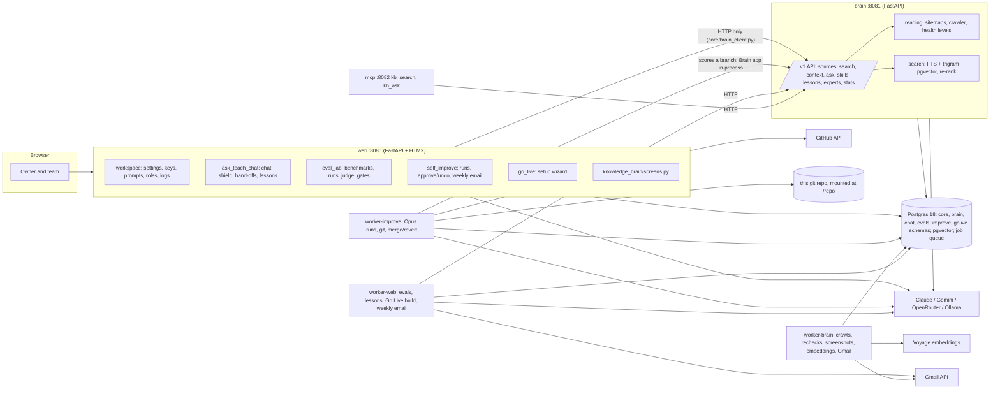

# Design

How the AI Tech Consultant is built, why, which model does what, what breaks, and what comes next. Every name below is a real file or service in this repo.

## 1. The system in one picture

**Two services, one hard line.** The Knowledge Brain (`knowledge_brain/`) is its own FastAPI service with its own database role (`brain_user`). Everything else (the web app and its workers) reaches it only through its HTTP API, using a per-business key (`core/brain_client.py`). The line is enforced twice: `tests/test_boundaries.py` fails the build if web-side code imports Brain code, and the `web_user` role has no rights on the `brain` schema (`tests/test_isolation.py`). The one audited exception is the Self-Improve scorer, which mounts the Brain's API app in-process to test a branch's Brain code, still speaking HTTP to it.

**One database for everything.** Postgres 18 holds the tables (6 schemas), search (full-text, `pg_trgm` typo matching, `pgvector` HNSW on halfvec(1024)), the job queue (Procrastinate) and a small cache. One thing to back up, one thing to run. On the 1,700-page snapshot a search through the Brain's API takes 124 ms on average and 242 ms for the slowest 5% (measured, EVALS.md); a separate vector database would add a service and a sync job for no gain at this size.

**Every business sees only its own rows.** Each business-owned table has `business_id` and a row-level-security policy; `core/db.py` sets `app.business_id` at the start of every transaction. A missing filter in a query can't leak another business's data, because the database adds the filter itself. Keys are encrypted with AES-GCM using the business id as associated data (`core/crypto.py`), shown masked once saved, and never logged.

## 2. The six features and their one-job agents

Each model call is one job with one prompt (`prompts/<key>/vN.md`, versioned per business in Settings) and a typed JSON reply. No agent framework: plain async Python, so every step can be read and explained.

| Job (router key) | What it does | Where | Default model |
| --- | --- | --- | --- |
| `tag_job` | rates an unclear question's complexity for the router | `core/llm/router.py` | Claude Haiku 5.5 |
| `find_facts` | picks the passages that answer the question, from the search hits | `ask_teach_chat/pipeline.py`, `knowledge_brain/answer.py` | Claude Haiku 5.5 |
| `write_answer` | writes the cited answer in the role's style | same | Claude Sonnet 5.5 |
| `read_screenshot` | describes a help-center screenshot, so it becomes searchable | `knowledge_brain/images.py` | Claude Haiku 5.5 |
| `write_lesson` | turns a correction into a lesson (rule, example, confidence) | `ask_teach_chat/teach.py` | Claude Opus 5.5 |
| `improve_skill` | proposes or drafts a skill change, from notes on past emails | `knowledge_brain/emails.py`, `knowledge_brain/api/knowledge.py` | Claude Opus 5.5 |
| `judge` / `judge_second` | scores an answer against the expected one; a free second opinion | `eval_lab/judge.py` | Claude Opus 5.5 / Nemotron 3 Ultra (free) |
| `make_tests` | writes the starting test set from the business's own pages | `go_live/starter.py` | Claude Sonnet 5.5 |
| Opus agent | edits code and prompts to fix failing cases | `self_improve/agent.py` | Claude Opus 5.5 (Agent SDK) |

Rules, not models, decide what has one right answer: the injection shield and hand-off rules (`ask_teach_chat/safety.py`), citation checks (`core/answers.py`), URL health levels (`knowledge_brain/health.py`), rule scoring in the Eval Lab (`eval_lab/rules.py`) and the release gate (`eval_lab/gate.py`).

**Feature 1, Settings.** Keys (Claude required; Gemini, OpenRouter, Ollama, Google optional), each tested on save. A model per step, a routing table (job x complexity -> model), every prompt and role as versions with a diff, and the release gate: a new version goes live only if no category's score drops on its gate cases.

**Feature 2, Knowledge Brain.** Five knowledge types plus documents. Sitemaps are planned before reading (counts, duplicates, first and last URL, time), read politely (robots.txt, rate per site, backoff), and rechecked on a schedule. A page that goes missing moves Active -> Watch -> Quarantined -> Archived after X misses, as a proposed action a person applies; a 301 quarantines the old URL and indexes the new one; a page that comes back returns to Active. Search is hybrid: keywords (OR of lexemes), typo repair (trigram candidates plus Damerau-Levenshtein, 1 edit up to 5 letters, 2 above), synonyms, and meaning (Voyage embeddings), fused with RRF and re-ranked 0 to 1.

**Feature 3, Ask and Teach Chat.** The shield runs first: injection rules, untrusted text fenced as data, a canary in the system prompt, and an output check for the canary or copied system text. Angry, refund and legal messages go to a person with a holding reply. Otherwise: find facts, write the answer with `[S1]` citations, drop invented citations, and say "I don't know" below the business's line (opening an expert task). A correction becomes a lesson that is used only after a person approves it; lessons are saved as `lessons/<topic>.md` with who, when, how sure, and the before-and-after judge score.

**Feature 4, Eval Lab.** Every case on every chosen model, scored by rules first and by the judge only where facts must be read. Runs save case by case and resume after an outage. Screens for the 14-model comparison (each number marked measured or projected), side by side, blind human grading against the judge, routing proof, feedback cases, release gates, local-only, and the "I don't know" line sweep.

**Feature 5, Self-Improve Loop.** Described in section 4.

**Feature 6, Go Live.** One wizard with a stopwatch: business and tone, keys, knowledge, Gmail, roles, build, readiness. The build reads a starter slice first (150 pages by default, about 3 minutes at 1 page per second) while the rest carries on, writes the starting test set from those pages (2 questions per page, with answer and source), runs it through the chat, and shows "answers 17 of 20 test questions correctly". The chat opens for the team only at the owner's level (90% by default).

## 3. Model choices

The defaults above are the plan, chosen on price and on v1 experience. They are **not yet measured on this benchmark**: no paid eval run has been made (see EVALS.md). The Eval Lab exists to replace these guesses with numbers.

| Step | Default | Why this one | Projected $ per 100 calls |
| --- | --- | --- | --- |
| Write the answer | Sonnet 5.5 | the step users read: it keeps the stronger model until the Eval Lab shows a cheaper one passes | $1.17 (Haiku $0.06, Opus $2.34) |
| Find facts, tag the job | Haiku 5.5 | picking passages is easy; 20x cheaper than Sonnet | $0.036 / $0.005 |
| Read a screenshot | Haiku 5.5 | v1 described the snapshot's 6,443 screenshots on Haiku through the Batch API | $0.022 |
| Lessons, skills, judge | Opus 5.5 | rare and high-stakes: a wrong lesson or a soft judge costs more than tokens | $2.80 / $2.80 / $0.64 |

"Projected" means typical tokens per call (measured on v1 prompts: a cited answer reads about 4,100 tokens and writes about 350) times the brief's price list. **The router** keeps cost down: rules set the complexity of most jobs, the tagger handles the unclear ones, the routing table maps job and complexity to a model, a failed quick check climbs the ladder (Haiku -> Gemini 3 Flash -> Sonnet -> Opus for answers), Haiku never gets a prompt over 100,000 tokens, and customer text never goes to a free model or Gemini unless the business allows it. If 60% of questions are easy enough for Haiku and quality holds, answers would cost about $0.50 per 100 instead of $1.17 (projected; the router proof in the Eval Lab measures it).

Claude calls use structured outputs, prompt caching on the system blocks, and the server-side refusal fallback on Sonnet and Opus. No call sets temperature, top_p or top_k.

## 4. The Self-Improve Loop, and why Opus can't cheat easily

1. A person picks an eval run with failures. The packer keeps the ones worth sending (safety cases, errors and URL cases stay with a person) and packs the comment, the live prompts, the failing answers with the judge's reasons, and the related files.
2. The base commit is exported (git archive) to a fresh folder **outside the repo, without the hidden check set and without history** (`self_improve/repo.py`). Opus works only there, through the Claude Agent SDK.
3. A PreToolUse hook fences every tool call (`self_improve/agent.py`): file tools only inside the folder and never the hidden set's path; the shell only runs an allowlist (pytest, ruff, pyright, ls, cat, grep...) with no pipes, variables or outside paths; secrets in its environment are blanked. Every call is logged per round, denied ones too.
4. After each round the app, not Opus, puts back any protected file (benchmark, tests, judge, rules, the loop, migrations, dependencies), rejects a change that copies a test question into the code or a prompt, runs the unit tests and scores the failing cases with the folder's own code in a separate process (`self_improve/evaluate.py`).
5. When every failing case passes, the other cases and the hidden set run. "Fixed" means no category dropped and the hidden set didn't drop. Otherwise the feedback goes into the next round. A round limit and a $ limit stop the run; the report says what was tried.
6. A fixed run becomes one commit on `improve/<date>-<id>` (and a pull request when GITHUB_TOKEN is set) with a report in `reports/self-improve/`. Approve merges it and turns each changed prompt into a new version through the release gate; Undo reverts the merge and brings back the previous prompt versions.

## 5. How the 4 feature ideas fit in

See [ROADMAP.md](ROADMAP.md). Each builds on what exists: the **Help-center gap finder** reads expert tasks and "I don't know" answers (Brain API), the **cost guardrails** read the call ledger (`core.model_calls`) and write the routing table, **inbox drafts** reuse the Gmail connection and the chat pipeline, and **multilingual answers** add a language to the chat pipeline and to the Eval Lab's categories.

## 6. What breaks, and what happens then

| If this stops | What users see | Protection |
| --- | --- | --- |
| Postgres | everything stops: it holds data, search and the job queue | the one single point of failure, by choice; health checks, restart policy, a volume to back up |
| The Brain service | the chat says it can't reach the knowledge; nothing invents an answer | the web app keeps working; jobs retry with backoff (10 tries) |
| A model provider | slower answers | fallbacks for busy free models, the router's ladder, retries; Claude's refusal fallback |
| Voyage | search by meaning is off | keyword and typo search still run; embeddings catch up later |
| A worker | jobs wait | jobs are rows in Postgres: nothing is lost; a crawl resumes from its per-URL rows |
| The laptop sleeps | long crawls pause | resumable runs; noted in the README |
| Gmail token revoked | no past-email sync, weekly email kept in the app | status "error" on the connection, shown in Settings |
| Opus misbehaves | its edit to a protected file is thrown away | section 4; a person approves every merge |

Known weak spots, honestly: no paid eval run yet, so the model choices are unproven; the Brain's crawler is tuned on one help center (Freshdesk); the Opus fence is defence in depth, not a sandbox (a determined process could find a way out of a shell allowlist), which is why the hidden set and a human review stay in the loop.

## 7. What comes next

1. Run the Eval Lab on the full benchmark with the 14 models (about $19 projected, EVALS.md) and replace every "projected" with "measured".
2. Tune the "I don't know" line from the sweep, and set the routing table from the cheapest model that passes per job.
3. Build the gap finder (ROADMAP.md), because it turns the "I don't know" answers this app already collects into new help pages.
