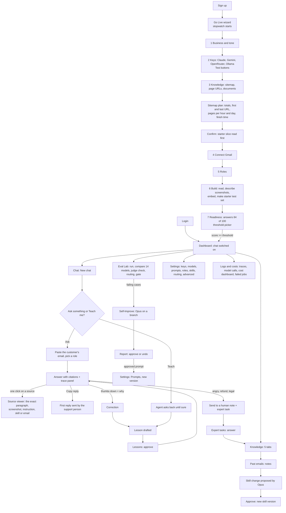

# UX.md: every screen, before building

Task 0. Every feature and task of the brief has a screen or a tab below; the wireframes show how a
user gets there. Screens are server-rendered (Jinja) with HTMX for the live parts (progress,
test chats, the trace panel), so every screen also works as a plain link.

## The layout every signed-in screen shares

```
+--------------------------------------------------------------------------------------+
| AI Tech Consultant   [ Business: Solution Center v ]        [?] Sumit (Owner) [Log out]|  top bar
+----------------+---------------------------------------------------------------------+
| Dashboard      |  Page title                                    [Primary action]     |  page header
| Go Live        |  -------------------------------------------------------------------  |
| Knowledge      |  [ Tab one ] [ Tab two ] [ Tab three ]   <- horizontal page tabs       |
| Chat           |                                                                      |
| Lessons        |  page content                                                        |
| Expert tasks   |                                                                      |
| Eval Lab       |                                                                      |
| Self-Improve   |                                                                      |
| Logs and costs |                                                                      |
| Settings       |                                                                      |
+----------------+---------------------------------------------------------------------+
   main menu (left)
```

Page tabs are **inside the page area**, never in the main menu: horizontal tabs just below the
page header (Knowledge, Eval Lab, Logs and costs, Lessons, Expert tasks, Self-Improve), or vertical
tabs on the left of the page (Settings, the Go Live wizard). The business switcher in the top bar
changes which business every screen shows. Day-one screens show what a new owner needs; anything
technical sits under **Settings > Advanced**.

## The map: from sign-up to the first reply sent



## Screen list

| # | Screen | URL | Tabs (where) |
| --- | --- | --- | --- |
| 1 | Sign up | `/signup` | - |
| 2 | Login | `/login` | - |
| 3 | Businesses (create, switch) | `/businesses` | - |
| 4 | Go Live wizard | `/setup` | vertical steps on the left: Business, Keys, Knowledge, Gmail, Roles, Build, Readiness |
| 5 | Dashboard | `/` | - |
| 6 | Knowledge | `/knowledge` | horizontal: Sitemaps, Page URLs, Instructions, Skills, Past emails, Documents |
| 6a | Sitemap plan (preview before reading) | `/knowledge/sources/{id}/plan` | - |
| 6b | Source detail | `/knowledge/sources/{id}` | horizontal: Progress, Pages, Refresh runs, URL health, Change history, Archived |
| 6c | Refresh run view | `/knowledge/runs/{id}` | - |
| 6d | Skill editor + test chat | `/knowledge/skills/{id}` | horizontal: Edit, Versions, Proposals |
| 6e | Email thread + notes | `/knowledge/emails/{id}` | - |
| 7 | Chat | `/chat`, `/chat/{id}` | - (chat list on the left, trace panel on the right) |
| 8 | Source viewer | `/sources/{chunk}` | - |
| 9 | Lessons | `/lessons` | horizontal: Pending, Approved, Off |
| 10 | Expert tasks | `/experts` | horizontal: Open, Answered, Dismissed |
| 11 | Eval Lab | `/evals` | horizontal: Benchmarks, Runs, Compare models, Side by side, Judge check, Routing, Feedback cases, Release gates, Local-only |
| 11a | Run detail | `/evals/runs/{id}` | - |
| 11b | Blind grading | `/evals/grade` | - |
| 12 | Self-Improve | `/improve` | horizontal: Runs, New run, Weekly emails |
| 12a | Run report | `/improve/runs/{id}` | - |
| 13 | Logs and costs | `/logs` | horizontal: Cost dashboard, Traces, Model calls, Failed jobs |
| 13a | Trace detail | `/logs/traces/{id}` | - |
| 14 | Settings | `/settings` | vertical on the left: Business, Keys and connections, Models, Prompts, Roles, Skills, Routing, Members and API keys, Advanced, Danger zone |
| 14a | Prompt editor | `/settings/prompts/{key}` | - |
| 14b | Role editor + test chat | `/settings/roles/{id}` | - |
| 15 | Brain API docs | `http://localhost:8081/docs` | - (for developers) |

## Every screen: what it shows, what you can do, where buttons lead

### 1. Sign up
Shows: name, email, password, business name. **Create account** -> creates the user and the
business (with the 3 starting roles, every default prompt, and the Brain API key) -> Go Live
wizard. "Already have an account?" -> Login.

```
+------------------------------------------+
|  Create your account                     |
|  Your name      [__________________]     |
|  Work email     [__________________]     |
|  Password       [__________________]     |
|  Business name  [__________________]     |
|  [ Create account ]                      |
|  Already have an account? Log in         |
+------------------------------------------+
```

### 2. Login
Email and password. **Log in** -> Dashboard of the last business used (or Businesses if none).
Demo logins are printed on the page in development.

```
+------------------------------------------+
|  Log in                                  |
|  Email     [__________________]          |
|  Password  [__________________]          |
|  [ Log in ]       New here? Sign up      |
|  Demo: owner@demo.local / demo1234       |
+------------------------------------------+
```

### 3. Businesses
Lists the businesses you belong to, with your role in each. **Open** -> switches the current
business -> Dashboard. **New business** -> name -> Go Live wizard for it. (The top-bar switcher
does the same from any screen.)

```
+-------------------------------------------------------------+
| Your businesses                          [ New business ]   |
|  Solution Center Demo    Owner   1,700 pages   [ Open ]     |
|  Acme Store              Owner     214 pages   [ Open ]     |
+-------------------------------------------------------------+
```

### 4. Go Live wizard (Feature 6)
A stopwatch at the top runs from step 1 to the readiness score; every step's time is saved
(Task 6.4). Vertical steps on the left; each step has **Back** and **Continue**.

1. **Business**: name, tone of voice (a choice + free text).
2. **Keys**: the 5 connections; Claude is required, the others optional; each has **Test**.
3. **Knowledge**: sitemap URLs, page URLs, upload documents (PDF, DOCX, MD, TXT). A sitemap is
   checked when entered; **Plan** shows the plan (6a) and **Confirm** starts reading.
4. **Gmail**: **Connect Gmail** -> Google sign-in -> back here, or **Skip**.
5. **Roles**: tick the roles to use (Support Engineer, Support Executive, AI Consultant).
6. **Build**: live progress: starter pages read, screenshots described, chunks embedded, starter
   test set made (Task 6.2), Eval Lab run.
7. **Readiness**: "Answers 84 of 100 test questions correctly", the threshold picker, **Switch on
   the chat** (only when the score reaches the threshold) -> Dashboard.

```
+-------------------------------------------------------------------------------+
| Go live in 15 minutes                                     Stopwatch  06:42     |
+------------------+------------------------------------------------------------+
| (v) 1 Business   |  3. Knowledge                                              |
| (v) 2 Keys       |  Sitemap URL [https://support.example.com/sitemap.xml] [Plan]|
| (>) 3 Knowledge  |  Page URL    [______________________________] [Add]          |
| ( ) 4 Gmail      |  Documents   [ Choose files ]  pricing.pdf  faq.docx         |
| ( ) 5 Roles      |  Plan: 1 sitemap, 1,700 URLs, first .../a, last .../z       |
| ( ) 6 Build      |  Starter slice: 150 pages now (~3 min), the rest after       |
| ( ) 7 Readiness  |                                   [ Back ]  [ Confirm ]      |
+------------------+------------------------------------------------------------+
```

### 5. Dashboard
Shows: readiness score and whether the chat is on; knowledge totals (pages processed, embedded,
failed, pending, duplicates skipped, last sync: Task 2.4); this week's questions, answers, hand-offs,
lessons waiting; cost this week; latest Self-Improve run; failed jobs. Every card links to its
screen.

```
+----------------------------------------------------------------------------------+
| Dashboard                                                                        |
| [Readiness 84/100  chat ON] [Pages 1,700 | embedded 1,541 | failed 0 | pending 0] |
| [Duplicates skipped 12 | last sync 08:00] [This week: 214 answers, 9 to humans]   |
| [Cost this week $3.12 ->]  [Lessons waiting 3 ->]  [Failed jobs 0 ->]             |
| [Latest Self-Improve: fixed 4 of 4, waiting for approval ->]                     |
+----------------------------------------------------------------------------------+
```

### 6. Knowledge (Feature 2)
Horizontal tabs, one per knowledge type (Task 2.1), plus Documents.

- **Sitemaps**: list (URL, pages, level counts, schedule, last sync, status). **Add sitemap** -> URL
  checked at once -> **Plan** (6a). Row -> Source detail (6b).
- **Page URLs**: add one URL at a time (checked, read, kept fresh, health-checked like sitemap
  pages); list with level and last check. Row -> Source detail.
- **Instructions**: list with on/off switch, roles it applies to. **New instruction** / **Edit** ->
  title, text, all roles or chosen roles; **Delete**.
- **Skills**: list (name, when to use, live version, waiting proposals). **New skill** -> write by
  hand, or "Describe it and let the agent draft it" -> Skill editor (6d).
- **Past emails**: **Fetch threads** from the connected Gmail; list of threads (subject, people,
  messages, notes). Row -> Thread (6e).
- **Documents**: upload, list, delete; each document's text is searchable like a page.

```
+-----------------------------------------------------------------------------------+
| Knowledge                                                    [ Add sitemap ]      |
| [Sitemaps] [Page URLs] [Instructions] [Skills] [Past emails] [Documents]          |
|  URL                                  Pages  Active Watch Quar. Arch.  Next check |
|  support.example.com/sitemap.xml      1,700  1,688    8     4     0   Daily 08:00 |
|                                                                [ Open ]          |
+-----------------------------------------------------------------------------------+
```

#### 6a. Sitemap plan (Task 2.2)
Before anything is read: total sitemaps, total URLs, first and last URL, for each nested sitemap
too, with a final total; duplicates (with every sitemap they're in); pages per hour, pages per day
and the expected finish time at the chosen speed. Recheck schedule (daily, weekly, 15, 30 days), X and
the action rule. **Confirm and start reading** -> Source detail, Progress tab. **Cancel** ->
Knowledge.

```
+-----------------------------------------------------------------------------------+
| Plan the read: support.example.com/sitemap.xml                                    |
|  Sitemap                       URLs   First URL            Last URL                |
|  sitemap.xml (index)              -   -                    -                       |
|   +- sitemap-articles.xml      1,541  /articles/1001       /articles/9001          |
|   +- sitemap-folders.xml         159  /folders/1           /folders/159            |
|  Total                         1,700  (12 duplicates, listed below)                |
|  Speed 1 page/s: 3,600 pages/hour, 86,400/day, finishes in ~29 min (09:42)        |
|  Recheck [Daily v]  X [2 v]  Then [Quarantine, then archive v]                    |
|                                     [ Cancel ]  [ Confirm and start reading ]     |
+-----------------------------------------------------------------------------------+
```

#### 6b. Source detail
Horizontal tabs:
- **Progress**: live while reading (HTMX, every 2 s): done / total, failed, time left.
- **Pages**: every URL with level, last status, duplicates; row -> Source viewer.
- **Refresh runs**: one row per run: started, kind, fetched, new, changed, missing, moved; row ->
  Refresh run view (6c).
- **URL health**: **pending actions** first (URLs at or past X, with counts and the action proposed),
  **Apply** (all or ticked) / **Keep**; then Watch and Quarantined lists with history.
- **Change history**: changed pages by date; row -> the diff between versions.
- **Archived**: the Archived Knowledge Base; **Restore** puts a page back to Active.

```
+-----------------------------------------------------------------------------------+
| support.example.com/sitemap.xml                        [ Recheck now ] [Settings] |
| [Progress] [Pages] [Refresh runs] [URL health] [Change history] [Archived]        |
|  Pending actions (X = 2, rule: quarantine then archive)       [ Apply selected ]  |
|  [x] /articles/1203   404 x2        -> quarantine                                 |
|  [x] /articles/1977   missing x2    -> quarantine                                 |
|  [ ] /articles/2004   missing x4    -> archive                                    |
+-----------------------------------------------------------------------------------+
```

#### 6c. Refresh run view (Task 2.4)
First fetch and last fetch date and time, totals, and at the bottom the total number of URLs fetched,
with **Show all URLs** opening a clean, scrollable list (URL, status, outcome).

```
+-----------------------------------------------------------------------------------+
| Refresh run: Daily recheck, 14 Nov 2026                                           |
|  First fetch 14 Nov 08:00:03    Last fetch 14 Nov 08:29:41                        |
|  New 3   Changed 11   Unchanged 1,679   Missing 2   Moved 1   Failed 0            |
|  > Show all URLs (1,700)                                                          |
|    /articles/1001   304   unchanged                                               |
|    /articles/1002   200   changed                                                 |
|  Total URLs fetched: 1,700                                                        |
+-----------------------------------------------------------------------------------+
```

#### 6d. Skill editor + test chat (Tasks 2.5, 2.6)
Left: the Markdown (name, when to use, steps, 1-2 examples), variables help, **Save** (a new
version; goes through the release gate). Right: a test chat that uses the unsaved text. Tabs:
**Edit**, **Versions** (diff, **Restore** in one click), **Proposals** (changes Opus suggested from
notes or lessons: what changed, which notes it used, **Approve** / **Reject**).

```
+-------------------------------------------+---------------------------------------+
| Skill: Domain setup questions   v3 live   | Test this skill                        |
| [Edit] [Versions] [Proposals (1)]         |  You: my domain shows a parking page   |
|  # Domain setup                           |  Agent: 1. Point the A record to ...   |
|  When to use: DNS, domain, A record ...   |         Sources: [1] [2]               |
|  Steps: 1. ... 2. ... 3. ...              |  [ type a question or paste an email ] |
|  Example: ...                             |                                        |
|  [ Save as v4 ]                           |                                        |
+-------------------------------------------+---------------------------------------+
```

#### 6e. Email thread + notes (Task 2.6)
Every message in the thread, a note box on each message and one on the whole thread, **Submit
notes**. **Improve skills from notes** -> Opus proposes a skill change -> it appears in the skill's
Proposals tab and here, with the notes it used.

```
+-----------------------------------------------------------------------------------+
| Thread: "Domain not working after transfer"  (4 messages)                         |
|  Customer, 2 Oct: My domain shows ...                    [ + note on message ]     |
|  Support, 2 Oct: Please check ...                         Note: Too long. Give the |
|                                                           3 DNS steps first.       |
|  Note on the whole thread: [_____________________________]   [ Submit notes ]     |
|                                     [ Improve skills from notes ]                 |
+-----------------------------------------------------------------------------------+
```

### 7. Chat (Feature 3)
Left: chats, **New chat** -> "Ask something" or "Teach me", and a role. Middle: the conversation;
the header shows the mode and a **role switcher** (works mid-chat). Long pasted emails are fine:
the agent finds the real question and shows it. Each answer shows: its sources (one click ->
Source viewer), which knowledge types it used, **Copy reply**, thumbs up/down, and a comment box
(**This was right** / **This was wrong** + why + the right answer). "This is wrong, the right
answer is ..." typed in the chat also counts as teaching. Angry, refund and legal questions show a
**Send to a human** note instead of an answer, and an expert task is created. Right: the **trace
panel** for the selected answer: knowledge, skills, lessons used, the model, the $ cost, each step.

```
+--------------+---------------------------------------------+-----------------------+
| [ New chat ] | Ask - Role [Support Executive v]            | Trace                  |
| Domain help  |  You: (pasted email) Hi, I moved my domain  |  Model  Sonnet 5.5     |
| Refund ask   |       and now ...                           |  Cost   $0.0087        |
| Teach: tone  |  Question found: "Why does my domain show a |  Knowledge: sitemap (3)|
|              |  parking page?"                             |   screenshot (1)       |
|              |  Agent: Point your A record to ... [1][2]   |  Skill: Domain setup v3|
|              |  Used: sitemap, skill   [Copy reply]        |  Lessons: dns-steps    |
|              |  [thumbs up] [thumbs down] [Comment]        |  Steps: shield 2 ms,   |
|              |  [ type or paste a customer message ]  Send |  search 41 ms, ...     |
+--------------+---------------------------------------------+-----------------------+
```

### 8. Source viewer
Opens the exact paragraph (highlighted, scrolled to), the screenshot with its description, the
instruction, the skill version, the past email message, the lesson or the expert answer that an
answer cited. **Open original** -> the live page.

### 9. Lessons (Task 3.4)
Tabs **Pending**, **Approved**, **Off**. Each lesson: the Markdown (`lessons/<topic>.md`), who
taught it, when, the example, how sure the agent is, possible conflicts with other lessons.
**Edit**, **Approve**, **Switch off**, **Delete**. **Test before and after** -> Eval Lab run of the same
question with and without the lesson (Task 3.5).

```
+-----------------------------------------------------------------------------------+
| Lessons                                                                           |
| [Pending (3)] [Approved (12)] [Off (1)]                                           |
|  refunds.md   "Never promise a refund; send to Billing"   taught by Sumit, 14 Nov |
|  confidence 0.92   example: "Can I get my money back?"   conflicts: none          |
|  [ Edit ] [ Approve ] [ Delete ]                  [ Test before and after ]       |
+-----------------------------------------------------------------------------------+
```

### 10. Expert tasks (Task 3.2)
Questions the agent couldn't answer or handed over (reason, how often asked, the chat it came from).
**Answer** -> the answer is saved as knowledge (cited next time). **Dismiss**.

### 11. Eval Lab (Feature 4)
Horizontal tabs:
- **Benchmarks**: the versioned sets (Brain 100, URL 10, Chat 60, Teach 10, starter, feedback),
  case counts by category; **Run** -> pick models (the 14), job, judge -> Run detail (11a).
- **Runs**: every run with status, models, pass rate, cost; row -> Run detail.
- **Compare models**: per model and step: quality, $ for 100 runs, average and p95 time; the
  14-model table; a **Projected** badge on any number not yet measured.
- **Side by side**: one case, two models' answers with the judge's score and reason for each.
- **Judge check**: **Grade blind** (11b) -> agreement: "The judge agreed with me on 18 of 20 (90%)".
- **Routing**: the routing table (job x complexity -> model), router vs always-Sonnet proof.
- **Feedback cases**: test cases proposed from thumbs-down answers; **Accept** / **Reject**.
- **Release gates**: every gate: what was checked, scores before and after, passed or blocked.
- **Local-only**: the switch, and the quality drop per step on the 2 local models.

```
+-----------------------------------------------------------------------------------+
| Eval Lab                                                       [ New run ]        |
| [Benchmarks][Runs][Compare models][Side by side][Judge check][Routing][...]       |
|  Model             Job            Quality  $/100 runs  Avg s  p95 s               |
|  Sonnet 5.5        write answer   96%       $1.17       4.1    7.9   measured     |
|  Qwen 3.8 Max      write answer   --        $1.03       --     --    projected    |
|  Gemini 3 Flash    write answer   --        $0.31       --     --    projected    |
+-----------------------------------------------------------------------------------+
```

#### 11a. Run detail
Per case: question, expected, each model's answer, judge score and reason, rule checks, time, cost,
and a **note** box per case per model. Failing cases can be ticked -> **Send to Self-Improve**.

#### 11b. Blind grading
One result at a time, judge score hidden: question, expected answer, the app's answer. **Pass** /
**Fail** + note -> next. After 20: the agreement with the judge.

### 12. Self-Improve (Feature 5)
Tabs **Runs** (status, failing cases, rounds, $, PR link), **New run** (the failing cases picked
in the Eval Lab, the comment, limits: max rounds, max $), **Weekly emails** (each week's email,
sent or stored).

#### 12a. Run report
What failed, what Opus changed (files and diff), scores before and after (given cases, all other
cases, hidden set), cost, rounds, blocked edits to protected files. **Approve and merge** (one
click; changed prompts and skills appear as new versions in Settings) / **Reject**; after merging,
**Undo** (one click, reverts the merge).

```
+-----------------------------------------------------------------------------------+
| Run 3: "Refund answers too vague"            fixed, waiting for you               |
|  Failing cases 4 -> 0   Other cases 97% -> 97%   Hidden set 95% -> 96%            |
|  Rounds 2 of 5   Cost $1.84 of $5.00   Branch improve/run-3   PR #12              |
|  Changed: prompts/chat.answer_system (v4 -> v5), ask_teach_chat/safety.py         |
|  Blocked: none                                                                    |
|  [ Approve and merge ]  [ Reject ]                                                |
+-----------------------------------------------------------------------------------+
```

### 13. Logs and costs (Task 1.5)
Tabs **Cost dashboard** ($ per day, per step, per model, per role; the costliest step for 100 runs),
**Traces** (every run; row -> Trace detail: every step, its time, every model call with tokens and $),
**Model calls** (the ledger, masked previews), **Failed jobs** (jobs that kept failing; **Retry**).

### 14. Settings (Feature 1)
Vertical tabs on the left:
- **Business**: name, tone, readiness threshold, the "I don't know" line.
- **Keys and connections**: the 5 connections, keys masked (never shown again), **Test** each,
  **Connect Gmail**.
- **Models**: the model for each step, from the 14.
- **Prompts**: every prompt (system prompts, user templates, answer, lesson, skill, judge); row ->
  Prompt editor (14a).
- **Roles**: the roles; **New role**; row -> Role editor (14b).
- **Skills**: the same skill list and editor as Knowledge > Skills (edited here too, Task 2.5).
- **Routing**: the routing table (Task 4.3).
- **Members and API keys**: who belongs to the business; Brain API keys (**Create**, shown once;
  **Revoke**).
- **Advanced**: synonyms, crawl speed, retries, the caching proof runner, local-only switch.
- **Danger zone**: **Delete this business** (type its name to confirm): every file, record and
  embedding goes.

```
+------------------------+----------------------------------------------------------+
| Business               | Keys and connections                                     |
| Keys and connections   |  Claude      sk-ant-...a1b2   OK (14 Nov 09:12)  [Test]   |
| Models                 |  Gemini      AIza...9f3c      OK                 [Test]   |
| Prompts                |  OpenRouter  sk-or-...77de    not tested         [Test]   |
| Roles                  |  Ollama      http://localhost:11434  2 models    [Test]   |
| Skills                 |  Gmail       not connected          [ Connect Gmail ]     |
| Routing                |  [ Replace key ]                                         |
| Members and API keys   |                                                          |
| Advanced               |                                                          |
| Danger zone            |                                                          |
+------------------------+----------------------------------------------------------+
```

#### 14a. Prompt editor (Task 1.3)
The live version's text, the variables it uses (and the ones it must keep), a warning before saving
if one is missing. **Save** -> a new version (the release gate checks it before it goes live).
**Versions**: every version with author (default, human, self-improve) and status; **Diff**,
**Restore** (any version, or the default) in one click.

```
+-----------------------------------------------------------------------------------+
| Prompt: chat.answer_system            live v4 (human)       [Versions] [Restore]  |
|  Variables: {role_prompt} {tone} {instructions} {skill}   must keep: {skill}      |
|  +-----------------------------------------------------------------------------+  |
|  | You are the support agent of {business_name}. ...                           |  |
|  +-----------------------------------------------------------------------------+  |
|  ! {skill} is missing. Save anyway?                    [ Cancel ] [ Save as v5 ]  |
+-----------------------------------------------------------------------------------+
```

#### 14b. Role editor + test chat (Task 1.4)
Left: name, goal, prompt, tone, skills (what it may do), knowledge sources, model, when to hand over.
Right: a test chat that uses the unsaved settings at once. **Save** -> new version (gated).

```
+-------------------------------------------+---------------------------------------+
| Role: AI Consultant                v2     | Test this role                         |
|  Goal  [Understand the need, propose ...] |  You: we need a directory for vets     |
|  Tone  [Warm, confident, sales-level   ]  |  Agent: Happy to help! For a vet ...   |
|  May   [x] answer [x] draft reply         |         Next step: a 15-min call ...   |
|        [x] expert task [x] share price    |                                        |
|  Knowledge [x] sitemap [x] skills [ ] ... |  [ type a question or paste an email ] |
|  Model [Router v]  Hand over [refunds...] |                                        |
|  [ Save as v3 ]                           |                                        |
+-------------------------------------------+---------------------------------------+
```

## Checklist: every task has a place

| Task | Screen |
| --- | --- |
| 1.1 sign-up, businesses, delete | 1, 2, 3, 14 Danger zone |
| 1.2 keys, local models, Gmail, Test, models per step | 14 Keys and connections, 14 Models, 4 step 2 |
| 1.3 prompts, variables, versions, caching proof | 14a, 14 Advanced |
| 1.4 roles, editor, test chat | 14 Roles, 14b, 7 role switcher |
| 1.5 logs, traces, cost, masking, failed jobs | 13, 13a |
| 2.1 five knowledge types | 6 tabs |
| 2.2 sitemaps, plan, duplicates | 6 Sitemaps, 6a |
| 2.3 polite read, progress, images | 6b Progress, 8 |
| 2.4 schedule, dashboard, refresh runs, health, archive | 6a, 5, 6b, 6c |
| 2.5 instructions, skills, drafting, test chat, versions | 6 Instructions, 6d, 14 Skills |
| 2.6 past emails, notes, Opus skill changes, approval | 6 Past emails, 6e, 6d Proposals |
| 2.7 search | used by 7; measured in 11 |
| 2.8 API | 15 |
| 3.1 ask or teach, pasted emails | 7 New chat |
| 3.2 answers, citations, roles, ask a human | 7, 8, 10 |
| 3.3 trace panel | 7 right panel, 13a |
| 3.4 lessons | 7 comment box, 9 |
| 3.5 before and after | 9 Test before and after, 11 Runs |
| 3.6 shield, send to a human | 7 (Send to a human note), 10 |
| 4.1 benchmark, judge, blind grading, side by side | 11 Benchmarks, 11b, 11 Side by side |
| 4.2 14 models, notes, local-only | 11 Compare models, 11a, 11 Local-only |
| 4.3 router | 11 Routing, 14 Routing |
| 4.4 feedback becomes tests | 7 thumbs, 11 Feedback cases |
| 4.5 release gate | 11 Release gates, 14a, 14b, 6d |
| 5.1-5.3 Self-Improve | 11a Send to Self-Improve, 12, 12a |
| 5.4 weekly email | 12 Weekly emails |
| 6.1-6.4 Go Live | 4 |
